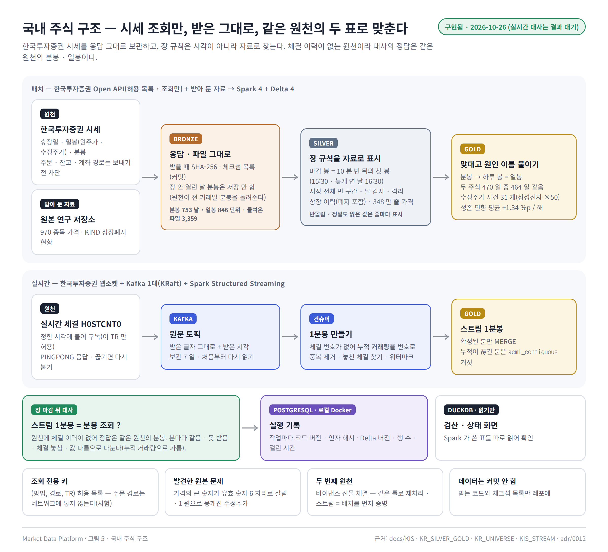
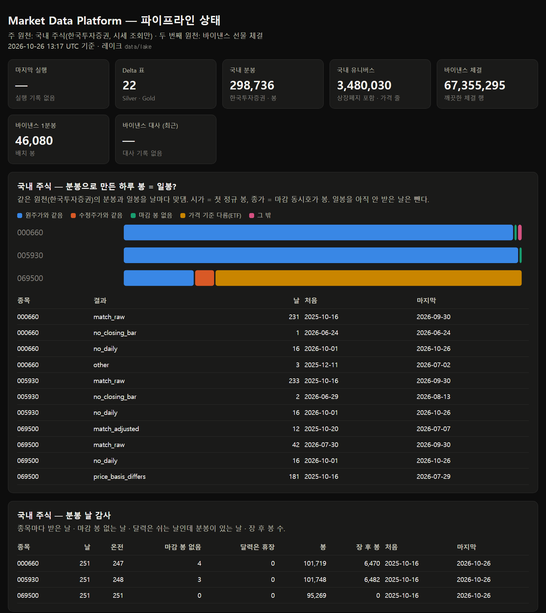
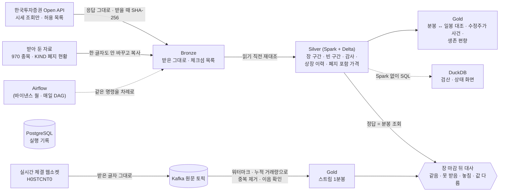

# Market Data Platform

**국내 주식 시세를 위한 단일 PC 레이크하우스 — 받은 그대로 보관하고, 장 규칙은 자료로 찾고, 같은 원천의 두 표를
맞대어 다르면 원인까지 나눈다.**

한국투자증권 Open API 의 시세를 **조회만** 해서(주문 · 잔고 · 계좌 경로는 코드가 보내기 전에 막는다) 응답 그대로
Bronze 에 보관하고, Spark · Delta Lake 로 Silver · Gold 를 만든다. 원천에 체결 이력이 없어서 '정답' 은 같은 원천의
분봉과 일봉이다 — 두 표를 날마다 맞대어 다른 날에는 원인 이름을 붙인다. 실시간 체결은 Kafka 를 거쳐 Spark
Structured Streaming 으로 1분봉을 만들고, 장이 끝나면 분봉 조회와 대사한다. 상장폐지 종목까지 담은 유니버스로
생존 편향을 해마다 숫자로 보인다.

> 개인 퀀트 연구 저장소의 자료 수집 코드를 데이터 엔지니어링 방식으로 다시 만든 프로젝트다. 먼저 바이낸스 선물
> 체결로 같은 틀(재처리 · 스트림 = 배치 · 대사)을 끝까지 증명했고([두 번째 원천](#두-번째-원천--바이낸스-선물-체결)),
> 그 틀에 국내 주식을 주 원천으로 올렸다([ADR 0012](docs/adr/0012-domestic-stocks-kis-quotes-only.md)).



## 숫자로 증명한 것 — 국내 주식

삼성전자 · SK하이닉스 · KODEX 200 — 분봉 2025-10-16 ~ 2026-10-26 (753 날 · 298,736 봉), 일봉 2015-01 ~ 2026-09
(원주가 · 수정주가). 유가증권시장 보통주 1,099 종목(상장폐지 242 개 포함) · 가격 348 만 줄.

| 무엇을 | 어떻게 확인했나 | 결과 |
|---|---|---|
| **조회만 한다** | (방법, 경로, TR) 허용 목록 밖의 요청을 보내 봄 | 주문 · 잔고 · 주문 가능 조회 · 주문용 해시 · 다른 호스트 모두 **네트워크에 닿기 전에** 멈춤 (시험 29 개) |
| **받기의 판단이 맞나** | 원천은 장이 안 열린 날을 물으면 **전 거래일 분봉**을 돌려준다 → 날짜가 다르면 저장 안 함 | 그렇게 거른 15 일 = 휴장일 달력의 평일 휴장 15 일, **정확히 같음** |
| **장 규칙을 자료로** | 마감 봉 = '동시호가 10 분 동안 비었다가 오는 첫 봉' (시각을 못 박지 않음) | 16:30 에 닫은 날(2025-11-13)까지 맞음 · 세 종목이 함께 30 분 빈 날 10 일 · 10 시 개장 2 일을 시장 전체로 표시 |
| **같은 원천의 두 표** | 분봉으로 만든 하루 시고저종 vs 일봉, 날마다 | 두 주식 **470 일 중 464 일 넷 다 같음**, 나머지 6 일은 모두 마감 봉이 없는 날 ([기록](docs/KR_SILVER_GOLD.md)) |
| **다른 날의 원인** | ETF 분봉이 원주가와 다른 기간 vs 수정주가 사건 날짜 | 다른 날이 정확히 **마지막 분배락(2026-07-30) 앞 날** — 분봉은 '받은 날 기준 수정 가격' 으로 온다 |
| **수정주가 사건** | 원천의 분할 표시 칸이 분할 날에도 비어 있음 → 원주가 ÷ 수정주가 비율로 찾기 | 사건 31 개 — 삼성전자 2018-05-04 **×50**(50:1 분할), KODEX 200 분기 분배락 30 개 |
| **생존 편향** | 해마다 연초 종목 전체 vs 지금도 상장된 종목만의 평균 수익률 | 18 해 중 14 해에서 생존 종목만이 높음, **평균 +1.34 %p / 해**(2010 년 +6.29 %p) ([기록](docs/KR_UNIVERSE.md)) |
| **원본 자료의 문제 찾기** | 평균 하나가 +654 % 로 튀는 것을 끝까지 따라감 | 원본 스크립트의 `:g` 형식 때문에 **큰 숫자가 유효 숫자 6 자리로 잘림**(100 만 주 넘는 거래량 전부) · 1 원으로 뭉개진 수정주가 ([발견 기록](docs/findings/2026-10-26-kr-imported-prices-rounding.md)) |
| **두 출처 대조** | 원본 저장소가 받아 둔 수정주가 vs 이 저장소가 새로 받은 일봉 | 5,724 날 **종가 모두 같음**, 거래량 차이는 최대 0.0005 % (= 6 자리 반올림) |
| **실시간** | 실전 웹소켓에 붙어 세 종목 구독 · PINGPONG | 구독 성공 · 끊김 0. 장 중 받기 → 스트림 1분봉 → 대사는 **결과 대기**(2026-10-27) ([기록](docs/KIS_STREAM.md)) |

## 상태 화면

Silver · Gold 표를 DuckDB 로 읽어(Spark 없이) HTML 한 장으로 — `python -m mdp.ui.report --serve 8765`
([기록](docs/STATUS_PAGE.md)).



## 이 프로젝트에서 푼 문제

**1. 체결 이력을 주지 않는 원천에서 '맞다' 를 어떻게 증명하나** — 바이낸스처럼 '과거 체결 파일 = 정답' 이 없다.
대신 **같은 원천의 두 표(분봉 · 일봉)가 서로 맞는지** 날마다 본다. 시고저종을 하나씩 따로 맞대야 '종가만 다름(마감
봉 없음)' 과 '넷 다 다름(가격 기준이 다름)' 이 갈린다. 실시간 대사의 정답도 장 마감 뒤 분봉 조회다.

**2. 장 시간을 못 박으면 틀린다** — 처음엔 '15:30 = 마감' 으로 정했는데 날마다 맞대 보니 16:30 에 닫은 날을 틀렸다.
그래서 규칙을 자료가 보여 준 모양으로 바꿨다: 마감 동시호가 10 분 동안은 봉이 없고 그 체결이 한 봉에 몰린다. 모든
종목이 같은 때 비는 구간은 시장 전체로 따로 표시한다 — 한 종목만 빈 분(체결 없음)과 섞으면 대사에서 원인을 못 가른다.

**3. 원천이 '조용히 틀린 답' 을 줄 때** — 장이 안 열린 날의 분봉을 물으면 오류 대신 **전 거래일 분봉**이 온다. 그대로
저장하면 엉뚱한 날짜에 다른 날 자료가 들어간다. 응답 날짜를 확인해 거르고, 거른 날이 휴장일 달력과 같은지로 그 판단을
검증했다.

**4. 체결 번호가 없는 실시간 체결** — 중복 제거와 놓친 체결 찾기에 쓸 번호가 없다. 체결마다 **누적 거래량이 그
체결량만큼 는다**는 점을 써서, 같은 누적이면 같은 체결로 보고, '앞 누적 + 이번 체결량 ≠ 이번 누적' 이면 그 사이를
놓친 것으로 본다.

**5. 주문도 되는 키를 조회에만** — 증권사 키는 같은 키로 주문을 부를 수 있다. '조심한다' 가 아니라 **코드가 못 하게**:
접속 창구가 (방법, 호스트, 경로, TR) 허용 목록 밖의 요청을 네트워크에 내보내기 전에 멈추고, 실시간도 체결 TR 하나만
구독한다. 받기 컨테이너에는 `.env` 전체가 아니라 그 키 이름들만 넘긴다.

**6. 받아 둔 자료를 믿기 전에** — 고치지 않고(Bronze 는 받은 그대로) 같은 원천에서 다시 받아 맞대고, 이상한 값은
줄마다 표시한다. 그렇게 원본 스크립트가 숫자를 6 자리로 잘라 쓴 것과, 1 원으로 뭉개진 수정주가가 평균을 +600 %p
흔든 것을 찾았다. 생존 편향 숫자는 그 값을 뺀 뒤에도, '폐지 직전 값' 을 쓰는 한계 때문에 **아래쪽 어림**이라고 적었다.

## 두 번째 원천 — 바이낸스 선물 체결

같은 틀을 먼저 바이낸스 선물 체결(키 없이 · 파일마다 체크섬을 주는 공개 아카이브)로 끝까지 증명했다. BTCUSDT
2024-03 한 달 — 체결 **66,512,993 행**.

<details>
<summary>바이낸스로 증명한 것 · 구조 그림 보기</summary>

| 무엇을 | 어떻게 확인했나 | 결과 |
|---|---|---|
| **정확성** | 같은 월 파일을 기존 연구 추출기로도 처리해 항목별 비교 | 매시 00분 점검값 **744/744 일치** — 기존 빠른 추출기의 [덩어리 경계 버그](docs/findings/2026-10-21-qflow216-check-minute-chunk-boundary.md)를 찾음 |
| **엔진 교차 검산** | Spark 가 쓴 표를 DuckDB 로 처음부터 다시 셈 | 불변 조건 위반 0 · 31 일 감사 값 소수점까지 일치, 9.5 초 |
| **재처리** | 감사 규칙을 바꿔 다시 만들고 Delta 시간여행으로 전후 7 개 표를 행 단위 비교 | 바뀐 것은 **10 행의 한 칸뿐**, `RESTORE` 뒤 7 개 표 모두 원래와 같음 ([기록](docs/REPROCESSING.md)) |
| **복사본 증명** | Delta → PostgreSQL 복사 뒤 양쪽에서 따로 SHA-256 | 44,640 행, 해시 같음 ([기록](docs/GOLD_BARS_1M.md)) |
| **스트림 = 배치** | 중복 1,441 · 지연 1,425 건을 섞어 하루를 Kafka 로 재생 | 스트림 1분봉 = 배치 봉 **1,440 분 모두 · 12 칸 모두** ([기록](docs/STREAM.md)) |
| **대사 원인 나누기** | PC 잠듦 · 30 분 지연 · 중복을 섞은 하루를 대사 | 못 받은 체결 **13,897 = 재생이 건너뛴 13,897**, 늦어서 빠진 **678 = Spark 가 버렸다고 보고한 678** ([기록](docs/RECONCILE.md)) |
| **멱등 오케스트레이션** | Airflow DAG 로 같은 달을 처음부터 다시 | 14 분, 다시 만든 7 개 표가 이전과 행 단위로 같음 ([기록](docs/AIRFLOW.md)) |
| **Spark 가 늘 답은 아니다** | 같은 과제를 네 방법으로 | DuckDB 12 초 · Spark 105 초 → 쓰기는 Spark + Delta, 읽기 · 검산은 DuckDB ([기록](docs/BENCHMARK.md)) |


</details>

## 2분 시연 — 키 · 큰 내려받기 없이

Docker Desktop 만 있으면 된다. 합성 종목 `DEMOUSDT` 3 일치(바이낸스 아카이브 모양)를 만들어 진짜 데이터와 **같은
명령**으로 끝까지 돌리고, 일부러 넣은 결함 5 종을 빠짐없이 찾았는지 정답지와 맞춘다([기록](docs/SAMPLE.md)).
국내 주식은 한국투자증권 키가 있어야 받을 수 있어 합성 시연은 아직 바이낸스 모양뿐이다.

```bash
pip install -e ".[dev,lake]"
python -m mdp.sample.demo --with-stream      # 107 초, 12/12 맞음
```

## 구조



| 층 | 담는 것 | 규칙 |
|---|---|---|
| **Bronze** | 원천 응답 · 파일을 받은 그대로 + 체크섬 목록(저장소에 커밋) | 덮어쓰지 않고 지우지 않는다. `.part` 폴더에 다 쓴 뒤 이름을 바꿔 반쪽이 남지 않게. 끝나지 않은 날은 받지 않는다 |
| **Silver** | 타입 있는 표 · 격리된 줄(이유와 함께) · 장 구간 · 빈 구간 · 날 감사 · 상장 이력 | 읽기 전에 Bronze 를 SHA-256 으로 다시 대조, 원천 칸은 뜻을 확인하기 전까지 이름만 풀어 그대로 |
| **Gold** | 두 표의 대조 결과와 원인 · 수정주가 사건 · 생존 편향 · 스트림 1분봉 · 대사 | Silver 에서만 만든다. 실행 기록에 읽은 Silver 버전(계보) |
| **PostgreSQL** | 실행 기록(코드 버전 · 인자 해시 · Delta 버전 · 행 수 · 걸린 시간) | 작고 자주 보는 것만 — 큰 데이터는 Delta |

## 설계 결정

결정마다 맥락 · 다른 안 · 치르는 값 · 잰 근거를 [결정 기록(ADR) 12 개](docs/adr/README.md)로 남겼다.

| 결정 | 한 줄 근거 |
|---|---|
| [주 원천은 국내 주식, 한국투자증권 시세 조회만](docs/adr/0012-domestic-stocks-kis-quotes-only.md) | 주문 · 잔고 · 계좌 경로는 보내기 전에 막힘(시험), 체결 이력이 없어 정답은 같은 원천의 분봉 |
| [Bronze 는 받은 그대로](docs/adr/0001-bronze-immutable.md) | 규칙을 바꿔 다시 만들어도 바뀐 것만 바뀐다(10 행) |
| [표 형식은 Delta Lake](docs/adr/0002-delta-lake.md) | 바꿔 끼우기 · 시간여행 · RESTORE · MERGE 를 모두 썼다 |
| [쓰기는 Spark, 읽기 · 검산은 DuckDB](docs/adr/0003-spark-writes-duckdb-reads.md) | 같은 과제 DuckDB 12 초 · Spark 105 초, 셋 다 같은 답 |
| [PostgreSQL 에는 작은 표만](docs/adr/0004-postgres-small-tables.md) | 체결 64.6 억 행은 행 저장소로 수백 GB(추정) |
| ['이미 받았나' 는 커밋한 체크섬 목록](docs/adr/0005-manifest-as-state.md) | 실행 기록 DB 가 꺼져도 같은 판단, 다시 돌리면 원천에 0 번 묻기 |
| [가격 · 수량은 decimal](docs/adr/0006-decimal.md) | 엔진이 달라도 '정확히 같음' 으로 비교할 수 있다 |
| [단일 PC 그대로](docs/adr/0007-single-pc.md) | 클러스터처럼 꾸미지 않는다 — 대신 치르는 값을 적었다 |
| [Airflow 는 순서만](docs/adr/0008-airflow-orders-only.md) | DAG 로 다시 만든 7 개 표가 손으로 만든 것과 같다 |
| [스트림: 원문 토픽 · 확정된 분만](docs/adr/0009-stream-raw-topic.md) | 원문을 다시 읽어 늦은 체결 복구 |
| [대사: 배치가 정답, 원인은 원문으로](docs/adr/0010-reconcile-batch-is-truth.md) | 원인 숫자가 독립된 두 기록과 같다 |
| [공개 시연은 합성 데이터 + 정답지](docs/adr/0011-synthetic-sample.md) | 감사가 일하는 것을 숫자로 보여 준다 |

## 진짜 데이터로 돌리기

<details>
<summary>국내 주식 (한국투자증권 키 필요 — 시세 조회만)</summary>

`.env` 에 `KIS_PAPER_APP_KEY` · `KIS_PAPER_APP_SECRET`(모의투자, 기본) 또는 `MDP_KIS_ENV=real` 과 `KIS_APP_KEY` ·
`KIS_APP_SECRET`. 계좌 번호는 넣지 않는다([원천 문서](docs/KIS.md)).

```bash
pip install -e ".[dev,lake]"
docker compose --profile db up -d          # PostgreSQL (실행 기록)
docker compose --profile spark build       # Spark + Delta 이미지 (한 번)

# Bronze — 휴장일 · 일봉(원주가 · 수정주가) · 분봉, 받아 둔 자료 들여오기
python -m mdp.bronze.kis --kind holiday --start 2025-10-01 --end 2026-09-30
python -m mdp.bronze.kis --kind daily  --symbols 005930,000660,069500 --start 2015-01-01 --end 2026-09-30
python -m mdp.bronze.kis --kind minute --symbols 005930,000660,069500 --start 2025-10-01 --end 2026-10-26
python -m mdp.bronze.imported --source ../Auto_Trading/data/research/kr_stocks --name auto_trading/research/kr_stocks

# Silver · Gold
docker compose run --rm spark python -m mdp.silver.kr_stocks      # 81 초
docker compose run --rm spark python -m mdp.gold.kr_stocks        # 19 초
docker compose run --rm spark python -m mdp.silver.kr_universe    # 약 1 분
docker compose run --rm spark python -m mdp.gold.kr_universe      # 약 26 초

# 실시간 — 아침에 띄워 두면 정한 시각에 붙고 멈춘다, 장 마감 뒤 대사
docker compose --profile stream up -d
docker compose --profile stream run -d --name mdp-kis-capture kis-capture python -m mdp.stream.kis_produce \
    --symbols 005930,000660,069500 --start-at 2026-10-27T08:40 --stop-at 2026-10-27T15:45
docker compose run --rm spark python -m mdp.stream.kis_bars --trigger available-now
docker compose run --rm spark python -m mdp.reconcile.kis_daily --date 2026-10-27

python -m mdp.ui.report --serve 8765       # 상태 화면 http://127.0.0.1:8765
```

</details>

<details>
<summary>바이낸스 선물 체결 (키 없음 — BTCUSDT 2024-03, 처음 받기 약 850MB)</summary>

```bash
python -m mdp.bronze.sync --dataset aggTrades --symbol BTCUSDT --start 2024-03-01 --end 2024-03-31
python -m mdp.bronze.sync --dataset klines --interval 1m --symbol BTCUSDT --start 2024-03-01 --end 2024-03-31
docker compose run --rm spark python -m mdp.silver.agg_trades --symbol BTCUSDT --month 2024-03
python -m mdp.query.check_silver --symbol BTCUSDT --month 2024-03          # DuckDB 교차 검산
docker compose run --rm spark python -m mdp.gold.bars_1m --symbol BTCUSDT --month 2024-03
python -m mdp.serve.bars_1m --symbol BTCUSDT --month 2024-03               # PostgreSQL 복사 · 체크섬
python -m mdp.reprocess.main --symbol BTCUSDT --month 2024-03 --volume-tolerance-pct 0.0001
docker compose run --rm spark python -m mdp.stream.produce --source replay --symbol BTCUSDT \
    --start 2024-03-01T00:00 --end 2024-03-02T00:05 --fresh-topic --duplicate-every 997 --delay-every 1009 --delay-ms 5000
docker compose run --rm spark python -m mdp.stream.bars_1m --trigger available-now --fresh
docker compose run --rm spark python -m mdp.reconcile.daily --symbol BTCUSDT --date 2024-03-01 --repair
docker compose --profile airflow up -d && docker exec mdp-airflow-1 airflow dags test mdp_monthly_pipeline 2024-03-01
```

</details>

시험과 검사:

```bash
pytest tests/mdp                                                   # 파이프라인 시험 166 개 (PostgreSQL 시험 4 개는 MDP_TEST_PG_DSN 있을 때)
docker compose run --rm spark python -m pytest tests/mdp/spark -q  # Spark 시험 31 개 — 실제 Structured Streaming 포함
bash scripts/ci_local.sh                                           # CI 와 같은 조건(파이썬 3.11 · 리눅스)으로 ruff · 서식 · mypy · import 계약 · pytest · 누출 시험
```

## 기술 스택

| 구분 | 사용 |
|---|---|
| 원천 | 한국투자증권 Open API(REST 시세 조회 · 실시간 웹소켓, 허용 목록으로 조회만) · KIND · 바이낸스 공개 아카이브 · WebSocket |
| 처리 | Apache Spark 4.0.1 · Delta Lake 4.0.1 · Spark Structured Streaming (RocksDB 상태 저장소) |
| 조회 · 검산 | DuckDB 2.0 (`delta_scan` · 시간여행) |
| 스트림 | Apache Kafka 4.3 (KRaft 1 대) · confluent-kafka · websockets |
| 저장 | Delta(파일 레이크하우스) · PostgreSQL 17 (실행 기록, 마이그레이션 SQL 을 체크섬으로 지킴) |
| 오케스트레이션 | Apache Airflow 3.1 (LocalExecutor, Spark 단계는 DockerOperator) |
| 실행 환경 | Docker Compose 프로필 `db` · `spark` · `stream` · `airflow` — 필요할 때만 켠다 |
| 품질 | Python 3.11+ · pytest · mypy(strict) · ruff · import-linter · gitleaks · GitHub Actions |

## 저장소 구조

```text
src/mdp/           데이터 파이프라인 (이 프로젝트의 본체)
  kis/                                한국투자증권 접속 창구(조회만) · 실시간 체결 읽기
  bronze/ silver/ gold/ serve/        층마다 하나 — 국내 주식(kis · kr_*) · 받아 둔 자료(imported) · 바이낸스
  stream/ reconcile/                  Kafka 스트림 · 대사 (국내 kis_* · 바이낸스)
  query/ bench/ reprocess/ verify/    DuckDB 검산 · 벤치마크 · 재처리 · 기존 추출기 비교
  orchestrate/ runlog/ ui/ sample/    Airflow 도우미 · 실행 기록 · 상태 화면 · 키 없는 시연
airflow/dags/      바이낸스 월 파이프라인 · 매일 대사 DAG
docker/            Spark + Delta 이미지 · Airflow 이미지
manifests/bronze/  받은 원천 파일의 체크섬 목록 (데이터 대신 커밋)
tests/mdp/         파이프라인 시험 (spark/ 는 컨테이너 안)
docs/              단계 기록 · 결정 기록(adr/) · 그림 원본 · 발견 기록
src/auto_trading/ · scripts/   원본 퀀트 연구 저장소에서 옮겨 온 연구 코드 (주문 기능 없음 — 아래)
```

자세한 지도는 [docs/CODE_MAP.md](docs/CODE_MAP.md), 단계별 진행은 [docs/ROADMAP.md](docs/ROADMAP.md).

## 한계 — 아직 확인하지 않은 것

- **실시간 대사**: 접속 · 구독까지 확인했고, 장 중 받기 → 스트림 1분봉 → 분봉 조회와의 대사는 2026-10-27 결과 대기다.
  분봉의 분 이름이 '분의 시작' 인지, 마감 동시호가 체결이 몇 초로 오는지도 그때 확인한다.
- **범위**: 분봉은 세 종목 · 약 1 년(원천 보관 기간 — 날마다 하루씩 밀려나 받지 않은 날은 영영 못 받는다), KRX 만
  (넥스트레이드 · 통합 체결은 아직), 정규장 · 마감 봉만 대사한다(장 후 시간외는 다른 TR).
- **원인을 확인하지 못한 것**: 세 종목이 함께 30 분 빈 구간(시장 전체 매매 정지로 보임) · 2026-09-14 부터 생긴 16:00 ~
  19:59 봉 · 10 시 개장 날 · 분봉 거래량 합이 일봉보다 작은 이유 · 원천 칸(`flng_cls_code` 등)의 뜻 — 공식 공지로 확인 필요.
- **생존 편향**: 폐지 직전 마지막 종가로 셈해 실제 손실보다 덜 나쁘게 잡힌다(아래쪽 어림), 배당 없음 · 단순 평균.
- **국내 주식 자동화 · 시연**: 국내 매일 DAG(Airflow)와 키 없는 국내 장 규칙 합성 시연은 아직 없다 — 오케스트레이션과
  합성 시연은 바이낸스 쪽에서 보였다.
- **키**: 국내 주식은 한국투자증권 키가 있어야 받는다. 이번 결과는 실전 키를 조회 전용으로 썼다(모의투자 키로 각 조회가
  되는지는 확인 필요).
- **데이터 재배포**: 데이터 파일은 커밋하지 않는다(받는 코드와 체크섬 목록만). 한국투자증권 · 바이낸스 자료의 재배포 조건은
  **확인 필요** — 확인 전까지 받은 데이터와 그 가공물을 공개하지 않는다.
- **옮겨 온 연구 코드**: `src/auto_trading` · `scripts` 는 원본 연구 저장소의 가상 장부(Paper) · 백테스트 · 연구 코드다.
  실주문 · 실계좌 코드는 모두 걷어 냈고([기록](docs/LIVE_REMOVAL_PLAN.md)), 남은 거래소 연결은 키 없는 공개 시세와 시험용
  가짜 거래소뿐이다.

## 문서

| 주제 | 기록 |
|---|---|
| 국내 주식 원천 — 조회 전용 접속 창구 · Bronze 받기 | [KIS](docs/KIS.md) |
| 국내 주식 Silver · Gold — 장 구간 · 분봉 ↔ 일봉 · 수정주가 사건 | [KR_SILVER_GOLD](docs/KR_SILVER_GOLD.md) |
| 국내 주식 유니버스 — 상장폐지 포함 · 생존 편향 | [KR_UNIVERSE](docs/KR_UNIVERSE.md) · [발견 기록](docs/findings/2026-10-26-kr-imported-prices-rounding.md) |
| 국내 주식 실시간 — 웹소켓 → Kafka → 스트림 1분봉 → 대사 | [KIS_STREAM](docs/KIS_STREAM.md) |
| 바이낸스 — Silver · 벤치마크 · Gold · 재처리 | [SILVER_AGG_TRADES](docs/SILVER_AGG_TRADES.md) · [BENCHMARK](docs/BENCHMARK.md) · [GOLD_BARS_1M](docs/GOLD_BARS_1M.md) · [REPROCESSING](docs/REPROCESSING.md) |
| 바이낸스 — Airflow · 스트림 · 대사 | [AIRFLOW](docs/AIRFLOW.md) · [STREAM](docs/STREAM.md) · [RECONCILE](docs/RECONCILE.md) |
| 키 없는 시연 · 상태 화면 | [SAMPLE](docs/SAMPLE.md) · [STATUS_PAGE](docs/STATUS_PAGE.md) |
| 결정 기록 · 단계별 진행 · 코드 지도 | [adr/](docs/adr/README.md) · [ROADMAP](docs/ROADMAP.md) · [CODE_MAP](docs/CODE_MAP.md) |
