<div align="center">

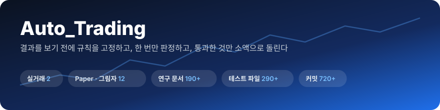

<br>


**사전 등록 연구 → 한 번 판정 → Paper → 소액 실거래**<br>
미국 레버리지 ETF · 원화 코인 · 국내외 주도주를 같은 원칙으로 시험하고 운영하는 개인 자동매매 저장소

</div>

---

## 📑 목차

| | | |
|:---|:---|:---|
| [1. 프로젝트 소개](#1-프로젝트-소개) | [4. 연구 결과 요약](#4-연구-결과-요약) | [7. 설치와 실행](#7-설치와-실행) |
| [2. 운영 중인 전략](#2-운영-중인-전략) | [5. 시스템 구조](#5-시스템-구조) | [8. 문서 지도](#8-문서-지도) |
| [3. 연구 방식](#3-연구-방식) | [6. 운영](#6-운영) | [9. 주의 · 라이선스](#9-주의--라이선스) |

---

## 1. 프로젝트 소개

> **"좋아 보이는 전략"이 아니라 "결과를 보기 전에 정한 규칙으로도 살아남는 전략"만 돈을 쓴다.**

2026-09 비트코인 선물 연구로 시작했습니다. 지금은 **미국 ETF(토스) · 원화 코인(업비트) · 국내외 주도주**까지 넓혀, 같은 방식으로 아이디어를 시험하고 통과한 것만 운영합니다.

| 원칙 | 무슨 뜻인가 |
|:---|:---|
| 📝 **사전 등록** | 규칙 · 숫자 · 통과 기준을 결과를 보기 **전에** 문서로 쓰고 커밋한다 |
| 1️⃣ **한 번만 판정** | 같은 자료로 숫자를 바꿔 다시 판정하지 않는다 (`Do not retry` 기록) |
| 💸 **비용 · 세금 포함** | 수수료 · 체결 불리폭 · 해외주식 양도세(250만 원 공제 22%)까지 넣는다 |
| 🌍 **세 겹 검증** | 실제 자료 + 합성 장기 자료(1986~) + 쓰지 않은 다른 시장 |
| 🧪 **Paper 먼저** | 통과해도 가상 장부로 앞으로의 자료를 쌓은 뒤 사용자가 승인해야 실거래 |
| 🛡️ **지정가만** | 시장가 주문 금지 (비상 정지 · 보호 실패 청산만 예외) |

---

## 2. 운영 중인 전략

### 💸 실거래

| | 이름 | 시장 | 한 줄 요약 | 주기 | 근거 |
|:-:|:---|:---|:---|:---|:---|
| 🪂 | **Glide** | 토스증권 · 미국 ETF | **TQQQ + SCHD** 변동성 비율 적립 + **T 브레이크** | 매달 첫 거래일 매수 · 매일 브레이크 확인 | [182](docs/research/182-leveraged-dividend-drawdown-control-preregistration.md) · [183~189](docs/research/184-m3-brake-after-tax-parking-preregistration.md) |
| 🛫 | **Cruise** | 업비트 · 원화 코인 | **BTC · ETH · SOL** T/v2 추세 추종 (현물 롱만) | 매일 09:05 | [16](docs/current/RESEARCH_HISTORY.md) · [190](docs/research/190-t2-upbit-and-sol-record.md) |
| 🌱 | 소액 적립 | 토스증권 · 미국 | BTQ · WQTM · QS 매일 1달러씩 모아 1주가 되면 매수 | 평일 21:00 | [89](docs/current/RESEARCH_HISTORY.md) · 118 |

<br>

#### 🪂 Glide — 나스닥 3배 + 배당주, 떨어질 땐 미끄러지듯

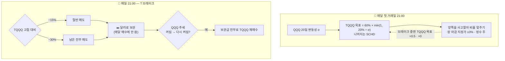

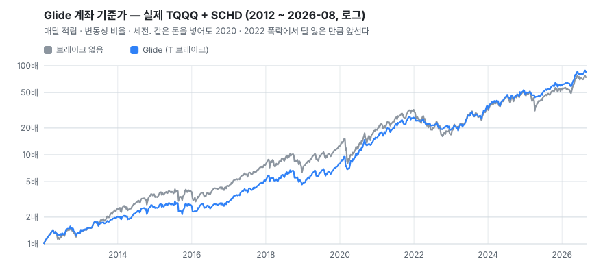

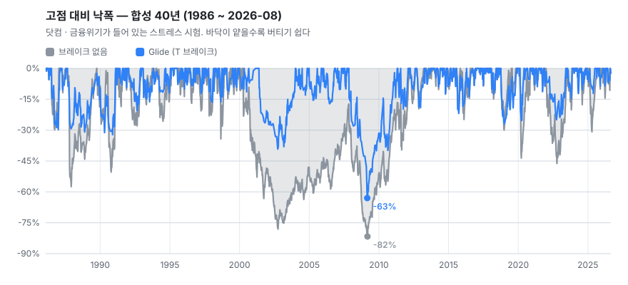

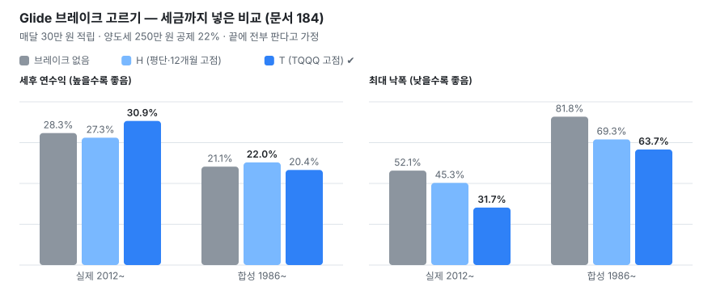

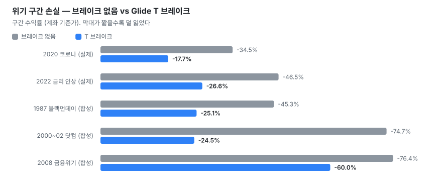

| 결정 | 고른 것 | 왜 |
|:---|:---|:---|
| 브레이크 기준 | **T (TQQQ 자체 고점)** | 실제 15년 세후 30.9% · 낙폭 32%. 위기 방어가 가장 강함 |
| 판 돈 보관 | **달러 그대로** | SCHD · QQQ 보관은 폭락 때 같이 빠짐, 국채 ETF는 이득 +0.4% 뿐 |
| 확인 주기 | **매일** | 매달 확인은 세후 30.9 → 21.5% |
| 재매수 신호 | **추세 20 · 60 · 120일** | 가격 회복 · RSI · MACD · 50일선 · 바닥 신호 · 20/50/100 모두 더 나빴음 |
| 비율 맞추기 | **양쪽 사고팔기** | SCHD 안 팔기는 세후 −5%p (싸게 사는 효과를 잃음) |

> [!NOTE]
> 백테스트 숫자는 **범위 안의 한 점**입니다. 추세 기간을 조금만 바꿔도 세후 연수익이 ±4~7%p 흔들렸습니다([188](docs/research/188-t-brake-rebuy-lookback-20-50-100-preregistration.md)). 브레이크의 확실한 효과는 **수익 증가가 아니라 낙폭 감소**입니다.

<br>

#### 🛫 Cruise — 코인은 추세가 있을 때만 탄다

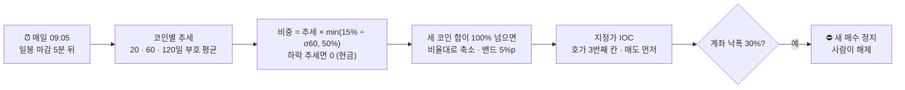

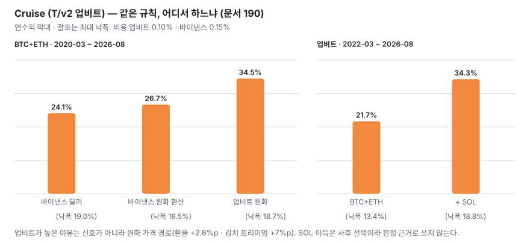

<br>

### 🧪 Paper · 그림자 (돈 없음, 앞으로의 자료 쌓기)

| 장부 | 무엇을 기록하나 | 시각 (KST) | 근거 |
|:---|:---|:---:|:---:|
| **T/v2** (바이낸스) | BTC · ETH 현물 추세 — Cruise 의 원본 | 21:00 | 16 |
| **T/v2 업비트** | 같은 규칙 원화판 | 21:02 | 190 |
| **O/v1 · O/v2 · O/v3** | T/v2 + 선물 추가 노출 1.5배 (O/v2 비상 스톱 · O/v3 2배) | 21:02~21:06 | 23~31 |
| **QS** | QQQ 적립 ↔ TQQQ 전환 (실거래는 껐음) | 21:15 | 116 |
| **AG** | 소액 공격형 세 계좌 | 21:17 | 117 |
| **LT** | 주도주 추세 보유 · 추매 | 21:10 | 115 |
| **MF** | 나스닥 + 추세 추종 · 채권 · 금 혼합 (ISA판 포함) | 07:40 | 177 · 178 |
| **T/v2 그림자** | 실주문 없이 주문 계산만 | 21:10 | — |
| **관찰 바구니** | 방향은 + 였지만 표본이 모자란 규칙 | 21:40 | 171 |
| **국장 그림자** | 국장 주도주 · 테마 | 20:20 | 143 |

<details>
<summary><b>🧰 데모 · 테스트넷 · 정보 알림 (펼치기)</b></summary>

| 종류 | 이름 | 하는 일 |
|:---|:---|:---|
| 데모 | Demo T/v2 · Demo O/v2 | 바이낸스 데모 계좌로 주문 경로 연습 (가짜 돈) |
| 테스트넷 | Testnet Drill | 주문 · 취소 · 보호주문 훈련 |
| 정보 | 📰 시장 브리핑 | 매일 미국 마감 뒤 하락 원인 정리 |
| 정보 | 🔥 테마 알림 | 토요일 09:00 국장 · 미국 주도 테마 + 주목 종목 (AI 요약 + 우리 자료 사실) |
| 정보 | 📊 TradFi 스냅숏 | 바이낸스 금 · 은 · 지수 무기한 실행 가능성 측정 |
| 점검 | 🩺 일일 점검 | 21:20 전체 상태 확인, 심각한 문제만 알림 |
| 백업 | 💾 상태 백업 | 23:30 `data/` · `reports/` 를 다른 디스크로 |

</details>

---

## 3. 연구 방식

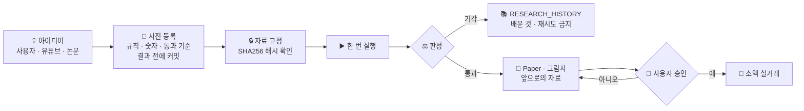

| 판정 | 뜻 |
|:---|:---|
| 🟢 `PASS` | 미리 정한 기준을 모두 넘음 |
| 🟦 `HISTORICAL_SUPPORT` | 과거 자료로는 지지 — 앞으로의 자료로 확인 필요 |
| 🔴 `REJECT` | 기준 미달. 같은 자료로 다시 시험하지 않음 |
| ⚪ `DATA_INSUFFICIENT` · `NO_ROOM` · `INCONCLUSIVE` | 자료 · 검정력이 모자라 판정 불가 |

| 검증 층 | 예 |
|:---|:---|
| **실제 자료** | TQQQ · SCHD 2012~, BTC · ETH 2018~, 업비트 원화 2020~ |
| **합성 장기 자료** | 나스닥 100 × 3배 (금리 · 보수 반영) 1986~ — 닷컴 · 금융위기 포함 |
| **다른 시장** | S&P 500 1928~1985 + 해외 지수 24개 (닛케이 · DAX · 코스피 …) |

---

## 4. 연구 결과 요약

<div align="center">
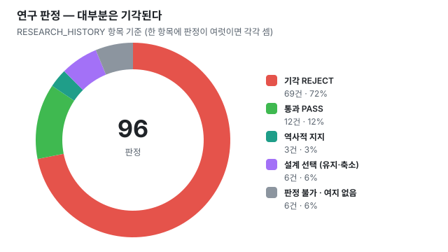
</div>

### ✅ 살아남은 것

| 이름 | 무엇 | 결과 | 지금 |
|:---|:---|:---|:---|
| **T** | BTC · ETH 시계열 추세 | `PASS` 샤프 0.95 | → T/v2 → 🛫 **Cruise** |
| **O/v1 · O/v2** | T/v2 + 선물 추가 노출 | `PASS` CAGR 33% vs 23% | Paper |
| **QS** | QQQ 추세 꺼지면 적립 멈춤 · 켜지면 TQQQ | `PASS` | Paper |
| **LEV-DIV-DDCTRL** | 레버리지 + 배당주 낙폭 브레이크 | `HISTORICAL_SUPPORT` | → 🪂 **Glide** |
| **NDX-BOND-GOLD** | 나스닥 60 · 국채 20 · 금 20 | `HISTORICAL_SUPPORT` | MF Paper |
| **AG · STAKE-CARRY · FLOW-KR** | 소액 공격형 · 스테이킹 · 국장 수급 | `PASS` (조건부) | Paper · 기록 |

### ❌ 많이 해 봤지만 안 된 것

| 분야 | 시험한 것 | 결론 |
|:---|:---|:---|
| 📉 바닥 잡기 | RSI · MACD · 볼린저 · 다이버전스 · 피보나치 · 지표 25개 투표 | 진짜 바닥과 가짜 바닥에서 **같은 신호**가 켜진다 |
| ⚡ 단타 · 이벤트 | 15분봉 되돌림 · CPI/FOMC · 거래량 급증 · 월말 효과 | 비용을 넘는 우위 없음 |
| 🧩 차트 패턴 | 엘리엇 파동 · 삼각형 · 박스 돌파 · 유튜버 방식 | 증거 없음 / 최근 사라짐 |
| 🏃 빨리 다시 타기 | 가격 회복 · 50일선 · 바닥 신호 · 짧은 추세 기간 | 반등은 더 잡지만 헛신호에 더 당함 |
| 🌏 나스닥 밖 3배 | 해외 지수 24개 가상 3배 | 대부분 낙폭 80~100% |

<details>
<summary><b>💡 배운 것 다섯 줄 (펼치기)</b></summary>

1. **추세 따라가기는 수익보다 낙폭을 줄인다.** T 브레이크는 다른 시장 12개 중 10개에서 브레이크 없음보다 나았다.
2. **바닥은 지나고 나서야 보인다.** 같은 "−30% + 반등" 신호가 닷컴 때 28번 켜졌고 대부분 틀렸다.
3. **비율 맞추기의 '싸게 사기'가 세금보다 크다.** SCHD 를 안 팔면 세금은 절반이지만 수익은 더 많이 준다.
4. **경로가 성과를 바꾼다.** 같은 T/v2 가 업비트에선 김치 프리미엄 · 환율 덕에 연 +10%p 높았다 — 앞으로를 보장하지 않는다.
5. **백테스트 숫자는 범위다.** 파라미터를 조금만 바꿔도 결과가 흔들린다 → 방향을 믿고, 숫자는 넓게 본다.

</details>

---

## 5. 시스템 구조

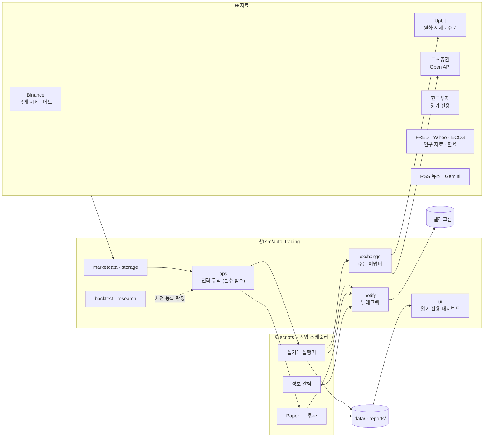

<details open>
<summary><b>📁 폴더 구조</b></summary>

```text
Auto_Trading/
├─ src/auto_trading/        핵심 패키지
│  ├─ core · config          타입 · 금액 · 시각 · 설정 검증 (가장 아래 계층)
│  ├─ marketdata · storage   시세 수집 · SQLite 장부 · 무결성 검사
│  ├─ exchange               Binance · Upbit · 토스 · 한국투자 어댑터
│  ├─ ops                    실거래 · Paper 규칙 (Glide · Cruise · QS …, 순수 계산)
│  ├─ backtest · research    백테스트 엔진 · 연구 모듈 (엘리엇 · 주도주 …)
│  ├─ risk · execution       위험 한도 · 주문 실행 · 킬스위치
│  ├─ notify                 텔레그램 · 알림 모양 (style.py)
│  ├─ ai · news · macro      뉴스 · 매크로 · AI 요약 (매매 경로와 분리)
│  └─ ui                     읽기 전용 대시보드
├─ scripts/                 실행기 (live_* · *_paper · toss_accumulate …)
│                           run_*.py = 사전 등록 연구의 1회 판정 스크립트
├─ tests/                   pytest — 가짜 거래소로만, 실제 주문 없음
├─ config/                  YAML 설정 (base · paper · testnet · live …)
├─ docs/
│  ├─ current/              현행 명세 · 연구 판정 기록
│  ├─ research/             번호 붙은 사전 등록 · 판정 문서 (001 ~ 191)
│  └─ archive/              지난 문서
└─ data/ · reports/         상태 · 보고 (git 밖, 매일 백업)
```

</details>

| 계층 규칙 (import-linter 로 강제) | |
|:---|:---|
| 순수 코어는 I/O 계층을 import 하지 않는다 | 같은 규칙 코드를 백테스트 · 실거래에서 그대로 쓴다 |
| UI 는 매매 로직을 import 하지 않는다 | 화면은 읽기만 한다 |
| 독립 연구는 매매 경로에서 import 하지 않는다 | 연구 코드가 실거래에 새어 들지 않는다 |

| 규모 | |
|:---|---:|
| 소스 파일 (`src/`) | 226 |
| 테스트 파일 (`tests/`) | 294 |
| 스크립트 (`scripts/`) | 244 |
| 연구 문서 (`docs/research/`) | 194 |
| 커밋 (2026-09-20 ~) | 720+ |

---

## 6. 운영

### ⏰ 하루 일정

```mermaid
gantt
    title 하루 일정 (KST · 평일)
    dateFormat HH:mm
    axisFormat %H:%M
    section 아침
    시장 브리핑                 :07:30, 10m
    MF Paper                    :07:40, 10m
    Glide 환전 알림             :09:00, 10m
    Cruise 실거래 (업비트)       :crit, 09:05, 15m
    section 낮
    Glide 금액 답 읽기 (5분마다) :09:00, 720m
    Glide 환전 알림 12·15시     :12:00, 180m
    section 밤
    국장 그림자                 :20:20, 10m
    Glide 실거래 (토스)          :crit, 21:00, 10m
    Paper T/v2 · O 계열         :21:00, 8m
    데모 · 테스트넷              :21:08, 8m
    LT · QS · AG Paper          :21:10, 10m
    일일 점검                   :21:20, 10m
    관찰 바구니                 :21:40, 10m
    TradFi 스냅숏               :22:45, 10m
    백업                        :23:30, 10m
    Glide 재시도                :23:40, 10m
```

토요일에는 09:00 테마 알림, 09:30 Cruise 주간 요약이 더해집니다.

### 📱 텔레그램 알림

| 알림 | 언제 오나 |
|:---|:---|
| 📈 Glide (토스) | 월초 금액 묻기 → 답하면 오늘 밤 계획 · 매수 결과 · 환전이 필요할 때 |
| 📌 Glide 공제 공지 | 12월 첫 평일 — 맨 위에 고정, **[전부 진행] [직접입력] [이번엔 안 함]** 버튼, 답이 없으면 마감 2일 전 한 번 |
| 💰 Glide 배당 단계 | SCHD 월 배당이 10 · 30 · 50 · 100만 원에 닿을 때 — 같은 버튼, 7일마다 다시 |
| 🛫 Cruise (업비트) | 매매 · 입금이 있는 날 · 토요일 09:30 주간 요약 |
| 📰 시장 브리핑 | 매일 미국 마감 뒤 |
| 🔥 테마 알림 | 토요일 09:00 (주목 종목 포함) |
| 🩺 일일 점검 | 심각한 문제가 있을 때만 |

> 브레이크 매도 · 재매수는 그때 알리지 않고, 다음 달 Glide 알림 맨 아래 **🛑 브레이크 매도 내역**에 모아 적습니다. 주문이 **실패**하면 바로 알립니다.
> 매달 Glide 알림 맨 아래에는 **🧾 올해 해외주식 양도세 추정**(실현 손익 · 남은 공제 · 예상 세금)도 붙습니다. 버튼에 답하면 봇이 "알겠습니다…" 로 답장하고, 그날 20:50 까지 **[취소]** 할 수 있습니다.

### 🛡️ 안전장치

| 장치 | 내용 |
|:---|:---|
| 지정가만 | 미국 ETF 는 장 마감 지정가(±3%), 코인은 지정가 IOC. 시장가 금지 |
| 거래 스위치 | `.env` 의 `TOSS_TRADING_ENABLED` · 업비트 키 권한 — 끄면 계산 · 알림만 |
| 긴급 정지 | `data/HALT` 파일이 있으면 모든 실행기가 주문하지 않음 |
| 낙폭 정지 | Cruise 계좌 낙폭 30% 면 새 매수 정지, 사람이 해제 (정지 30 일째부터 30 일마다 다시 알림 — 문서 199) |
| 주문 전 저장 | 보내기 전에 기록하고, 전송 결과를 모르면 다시 보내지 않음 |
| 비밀값 | API 키 · 토큰은 `.env` 에만 (git 밖), 출력하지 않음 |
| 백업 | 매일 23:30 상태 묶음을 다른 물리 디스크로, 30개 보관 |

---

## 7. 설치와 실행

```bash
python -m venv .venv
.venv/Scripts/activate          # Linux/macOS: source .venv/bin/activate
pip install -e ".[dev]"
pre-commit install
```

```bash
pytest -q                                   # 시험 (가짜 거래소)
ruff check . && mypy src                    # 검사
```

| 명령 | 하는 일 |
|:---|:---|
| `python -m scripts.toss_accumulate preview` | 오늘 밤 Glide · 적립 계획 미리 보기 (주문 없음) |
| `python -m scripts.toss_accumulate status` | Glide 장부 · 브레이크 상태 |
| `python -m scripts.live_t2_upbit plan` | Cruise 오늘 계획만 (주문 없음) |
| `python -m scripts.us_tax` | 올해 해외주식 양도세 추정 (토스 체결 · 한국은행 환율) |
| `python -m scripts.readme_charts` | 이 README 의 그래프 다시 그리기 |

> [!WARNING]
> 실거래 실행기는 `.env` 의 키와 거래 스위치가 있어야 주문합니다. 사용자 승인 없이 실거래를 켜거나 데이터를 지우지 않습니다.

---

## 8. 문서 지도

| 문서 | 읽을 때 |
|:---|:---|
| [AGENTS.md](AGENTS.md) | 작업 규칙 · 읽는 순서 (사람 · AI 공통) |
| [PROGRESS.md](PROGRESS.md) | 지금 무엇을 하고 있나 · 최근 결정 |
| [CURRENT_SPEC](docs/current/CURRENT_SPEC.md) | 현행 명세 · 결정 표 |
| [RESEARCH_HISTORY](docs/current/RESEARCH_HISTORY.md) | 모든 판정 요약 · 재시도 금지 목록 |
| [TRADING_CORE](docs/current/TRADING_CORE.md) · [OPERATIONS](docs/current/OPERATIONS.md) | 위험 한도 · 운영 · 예약 작업 |
| [BRIEFING_FOR_LLM](docs/BRIEFING_FOR_LLM.md) | 다른 AI 에게 붙여 넣는 요약본 |
| [docs/research/](docs/research/) | `NNN-주제-preregistration.md` — 사전 등록 원문 + 판정 |

---

## 9. 주의 · 라이선스

> [!CAUTION]
> 이 저장소의 결과는 과거 자료 시험과 짧은 실거래 기록입니다. **앞으로의 수익을 보장하지 않습니다.** 레버리지 ETF 와 코인은 원금 대부분을 잃을 수 있습니다.

**Proprietary** — 무단 사용 · 배포 금지.
