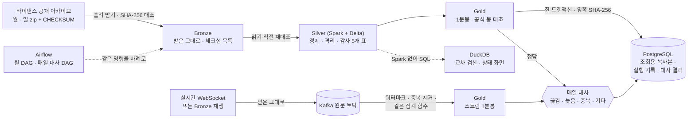

# Market Data Platform

**바이낸스 선물 체결 데이터를 위한 단일 PC 레이크하우스 — 배치 · 스트림 · 매일 대사까지, 모든 결과를 숫자로 증명한다.**

체결 기록(aggTrades)을 원본 그대로 보관하고(Bronze), Spark · Delta Lake로 정제 · 품질 감사한 뒤(Silver)
1분봉을 만든다(Gold). 같은 체결을 Kafka로 흘려 Spark Structured Streaming으로도 1분봉을 만들고, **두 봉이 분마다
같은지 매일 맞대어 다르면 원인까지 나눈다.** 모든 단계는 다시 돌려도 같은 결과가 나오고(멱등), 무엇을 어떤
코드로 만들었는지 PostgreSQL 실행 기록에 남는다. Airflow가 순서를 맡는다.

> 개인 퀀트 연구에서 쓰던 데이터 수집 · 감사 스크립트를 데이터 엔지니어링 방식으로 다시 만든 프로젝트다.
> 연구 스크립트는 원본 체결 86GB를 집계한 뒤 지웠고, 규칙을 바꾸려면 처음부터 다시 받아야 했다. 그 한계에서 출발했다.


## 숫자로 증명한 것

BTCUSDT 선물 2024-03 한 달치 — 체결 **66,512,993행** (원본 zip 847MB · 압축 해제 4.4GB → Delta 1.8GB).

| 무엇을 | 어떻게 확인했나 | 결과 |
|---|---|---|
| **정확성** | 같은 월 파일을 기존 연구 추출기로도 처리해 항목별 비교 | 매시 00분 점검값 **744/744 일치** — 그 과정에서 기존 빠른 추출기의 [덩어리 경계 버그](docs/findings/2026-10-21-qflow216-check-minute-chunk-boundary.md)를 찾음(한 분 8,490건 중 2,630건만 셈) |
| **엔진 교차 검산** | Spark가 쓴 표를 DuckDB로 처음부터 다시 셈 | 불변 조건 위반 0 · 31일 감사 값 **소수점까지 일치**, 9.5초 |
| **재처리** | 감사 규칙을 바꿔 다시 만들고 Delta 시간여행으로 전후 7개 표를 행 단위 비교 | 바뀐 것은 **10행의 한 칸뿐**, `RESTORE` 뒤 7개 표 모두 원래와 같음 ([기록](docs/REPROCESSING.md)) |
| **연구 재현** | Gold 1분봉으로 연구 문서의 숫자를 다시 계산 | "1,440분 중 1,110분 일치 · 하루 거래량 차 −3.5e-6"을 **같은 숫자로** ([기록](docs/GOLD_BARS_1M.md)) |
| **복사본 증명** | Delta → PostgreSQL 복사 뒤 양쪽에서 따로 SHA-256 | 44,640행, **해시 같음**, 2.4초 |
| **스트림 = 배치** | 중복 1,441건 · 지연 1,425건을 섞어 하루를 Kafka로 재생 | 스트림 1분봉이 배치 봉과 **1,440분 모두 · 12칸 모두 같음** ([기록](docs/STREAM.md)) |
| **대사 원인 나누기** | PC 잠듦 · 30분 지연 · 중복을 섞은 하루를 대사 | 못 받은 체결 **13,897 = 재생이 건너뛴 13,897**, 늦어서 빠진 **678 = Spark가 버렸다고 보고한 678** ([기록](docs/RECONCILE.md)) |
| **멱등 오케스트레이션** | Airflow DAG로 같은 달을 처음부터 다시 | 14분, 다시 만든 **7개 표가 이전과 행 단위로 같음** ([기록](docs/AIRFLOW.md)) |
| **키 없는 재현** | 결함 5종을 정해진 자리에 넣은 합성 데이터로 끝까지 | 명령 하나 107초, 정답지와 **12/12** ([기록](docs/SAMPLE.md)) |
| **성능** | Spark 지연 실행 때문에 반복되던 계산을 한 번으로 | Silver 한 달 **65분 → 18분**, 최적화 전후 차이 0행 |

## 2분 시연 — 키 · 큰 내려받기 없이

Docker Desktop만 있으면 된다. 합성 종목 `DEMOUSDT` 3일치를 바이낸스 아카이브와 같은 모양으로 만들어,
진짜 데이터와 **같은 명령**으로 끝까지 돌리고, 일부러 넣은 결함을 빠짐없이 찾았는지 정답지와 맞춘다.

```bash
pip install -e ".[dev,lake]"
python -m mdp.sample.demo --with-stream
```

```text
(출력 줄임)
[1/12] PostgreSQL 켜기 … [3/12] Silver (Spark) — 체크섬 재대조 → 정제 · 격리 · 빈 곳 · 날 대조 …
[9/12] 스트림 1분봉 (Structured Streaming) … [10/12] 매일 대사 · 메우기 … [12/12] 정답 맞추기 (DuckDB)
[OK ] 빈 곳 — 앞 번호 · 뒤 번호 · 빠진 수   정답 [(1029423, 1029429, 5)]  ·  실제 [(1029423, 1029429, 5)]
[OK ] 대사 — 끊김 분 · 받지 못한 체결 …      정답 (6, 76, 0, 0, 0)        ·  실제 (6, 76, 0, 0, 0)
12/12 맞음
```

끝나면 파이프라인 상태 화면이 만들어진다 (`data/sample/ui/index.html`, [기록](docs/STATUS_PAGE.md)):


## 구조



| 층 | 담는 것 | 규칙 |
|---|---|---|
| **Bronze** | 원천 zip을 원천 경로 그대로 + 체크섬 목록(저장소에 커밋) | 덮어쓰지 않고 지우지 않는다. 읽기 직전 SHA-256을 다시 대조 |
| **Silver** | 깨끗한 체결 · 격리된 줄(이유와 함께) · 파일 감사 · 빈 곳 위치 · 날 대조 | 모든 칸을 글자로 읽고 `try_cast`, decimal, 달 단위 `replaceWhere` |
| **Gold** | 배치 1분봉 · 공식 봉 대조 · 스트림 1분봉 | Silver에서만 만든다. 줄마다 읽은 Silver 버전(계보) |
| **PostgreSQL** | 실행 기록 · 대사 결과 · Gold 조회용 복사본 | 작고 자주 보는 것만 — 큰 데이터는 Delta |

## 이 프로젝트에서 푼 문제

**1. "같은 답인가"를 어떻게 증명하나** — 만든 엔진과 다른 엔진으로 센다. Spark가 만든 Silver를 DuckDB가 다시
세고, 기존 연구 추출기와도 항목별로 맞댔다. 세 방법이 모두 같은 답을 낸 덕분에, 혼자 다른 답을 낸 기존 빠른
추출기의 버그(32MB 덩어리 경계가 점검 분 중간에 걸리면 나머지를 건너뜀)를 원인까지 찾았다.

**2. 원본을 지우지 않으면 무엇이 되나** — Bronze를 그대로 두니 규칙을 바꿔 다시 만들 수 있다. 다만 "다시
만들었다"만으로는 믿을 수 없어서, Delta 시간여행으로 전후 버전을 키로 맞대 **무엇이 몇 행 바뀌었는지**를
남기고, 잘못이면 `RESTORE`로 되돌린 뒤 되돌린 것까지 확인했다.

**3. 스트림은 반드시 틀린다 — 그럼 어떻게 하나** — 개인 PC는 잠들고, 재연결 때 같은 체결이 두 번 오고, 늦게 온
체결은 워터마크에 버려진다. 목표를 '무중단'이 아니라 **'빈 곳을 정확히 찾아 메우기'** 로 잡았다. 스트림 봉과
배치 봉을 같은 집계 함수로 만들어 차이가 입력에서만 생기게 하고, 빠진 체결 번호가 **Kafka 원문 토픽에 있으면
'늦음', 없으면 '끊김'** 으로 가른다. 원인별 숫자가 보낸 쪽 · Spark가 따로 센 숫자와 정확히 같았다.

**4. Spark가 늘 답은 아니다** — 같은 과제를 네 방법으로 잰 결과 이 크기에서는 DuckDB가 12초, Spark가 105초였다
([벤치마크](docs/BENCHMARK.md)). 그래서 **쓰기(트랜잭션 · 달 단위 바꿔 끼우기 · 스트리밍)는 Spark + Delta, 읽기 ·
검산은 DuckDB**로 나눴다.

**5. Airflow가 Spark 컨테이너를 띄울 때의 폴더 경로** — DockerOperator가 띄우는 컨테이너는 호스트의 Docker가
만들므로 Airflow 안 경로가 아니라 호스트 경로를 붙여야 한다. PC마다 경로를 적는 대신, Airflow 컨테이너가 자기
연결 정보를 Docker에게 물어 호스트 경로를 찾게 했다. DAG에는 전용 처리 코드가 없고 평소 명령을 차례로 부를
뿐이라, 손으로 돌린 결과와 DAG 결과가 같은 코드에서 나온다.

**6. Spark Structured Streaming의 실제 동작** — 시험을 만들다 확인했다: 상태 연산자가 둘이면 늦음 판정에
**바로 앞 묶음의 워터마크**를 쓴다. 그래서 실제로 기다려 주는 시간은 '워터마크 + 묶음 하나'다. 같은 원문을
묶음 크기만 바꿔 처리하자 늦게 온 체결이 0건 버려지기도, 678건 버려지기도 했다 — 대사가 없었다면 몰랐을 차이다.

## 설계 결정

결정마다 맥락 · 다른 안 · 치르는 값 · 잰 근거를 [결정 기록(ADR) 11개](docs/adr/README.md)로 남겼다.

| 결정 | 한 줄 근거 |
|---|---|
| [Bronze는 받은 그대로](docs/adr/0001-bronze-immutable.md) | 규칙을 바꿔 다시 만들어도 바뀐 것만 바뀐다(10행) |
| [표 형식은 Delta Lake](docs/adr/0002-delta-lake.md) | 달 단위 바꿔 끼우기 · 시간여행 · RESTORE · MERGE를 모두 썼다 |
| [쓰기는 Spark, 읽기 · 검산은 DuckDB](docs/adr/0003-spark-writes-duckdb-reads.md) | 같은 과제 DuckDB 12초 · Spark 105초, 셋 다 같은 답 |
| [PostgreSQL에는 작은 표만](docs/adr/0004-postgres-small-tables.md) | 체결 64.6억 행은 행 저장소로 수백 GB(추정), 복사본은 해시로 증명 |
| ['이미 받았나'는 커밋한 체크섬 목록](docs/adr/0005-manifest-as-state.md) | 실행 기록 DB가 꺼져도 같은 판단 |
| [가격 · 수량은 decimal](docs/adr/0006-decimal.md) | 엔진이 달라도 '정확히 같음'으로 비교할 수 있다 |
| [단일 PC 그대로](docs/adr/0007-single-pc.md) | 클러스터처럼 꾸미지 않는다 — 대신 치르는 값을 적었다 |
| [Airflow는 순서만](docs/adr/0008-airflow-orders-only.md) | DAG로 다시 만든 7개 표가 손으로 만든 것과 같다 |
| [스트림: 원문 토픽 · 확정된 분만 · 같은 집계 함수](docs/adr/0009-stream-raw-topic.md) | 스트림 = 배치 1,440분, 원문을 다시 읽어 늦은 체결 복구 |
| [대사: 배치가 정답, 원인은 원문 토픽으로](docs/adr/0010-reconcile-batch-is-truth.md) | 원인 숫자가 독립된 두 기록과 같다 |
| [공개 시연은 합성 데이터 + 정답지](docs/adr/0011-synthetic-sample.md) | 감사가 일하는 것을 숫자로 보여 준다 |

## 진짜 데이터로 돌리기

<details>
<summary>명령 보기 (BTCUSDT 2024-03 — 처음 받기 약 850MB)</summary>

준비물: Python 3.11+, Docker Desktop, 디스크 약 1GB. 환경 변수 `MDP_BRONZE_ROOT`(Bronze 위치, 기본 `data/lake/bronze`) ·
`MDP_LAKE_ROOT`(Delta 표 위치, 기본 `data/lake`) · `MDP_PG_DSN`(실행 기록, 없으면 기록 없이).

```bash
pip install -e ".[dev,lake]"
docker compose --profile db up -d          # PostgreSQL (실행 기록 · 복사본 · 대사)
docker compose --profile spark build       # Spark + Delta 이미지 (한 번)

# 배치
python -m mdp.bronze.sync --dataset aggTrades --symbol BTCUSDT --start 2024-03-01 --end 2024-03-31
python -m mdp.bronze.sync --dataset klines --interval 1m --symbol BTCUSDT --start 2024-03-01 --end 2024-03-31
docker compose run --rm spark python -m mdp.silver.agg_trades --symbol BTCUSDT --month 2024-03
python -m mdp.query.check_silver --symbol BTCUSDT --month 2024-03          # DuckDB 교차 검산
docker compose run --rm spark python -m mdp.gold.bars_1m --symbol BTCUSDT --month 2024-03
python -m mdp.serve.bars_1m --symbol BTCUSDT --month 2024-03               # PostgreSQL 복사 · 체크섬
python -m mdp.reprocess.main --symbol BTCUSDT --month 2024-03 --volume-tolerance-pct 0.0001   # 재처리 · 비교
python -m mdp.bench.main --symbol BTCUSDT --month 2024-03 --rounds 2       # 벤치마크

# 스트림 · 대사
docker compose --profile stream up -d      # Kafka (이 PC 에서 127.0.0.1:57092)
docker compose run --rm spark python -m mdp.stream.produce --source replay --symbol BTCUSDT \
    --start 2024-03-01T00:00 --end 2024-03-02T00:05 --fresh-topic --duplicate-every 997 --delay-every 1009 --delay-ms 5000
docker compose run --rm spark python -m mdp.stream.bars_1m --trigger available-now --fresh
docker compose run --rm spark python -m mdp.reconcile.daily --symbol BTCUSDT --date 2024-03-01 --repair
docker compose run --rm spark python -m mdp.stream.produce --source live --symbol BTCUSDT --duration-s 300   # 실시간

# Airflow (화면 http://127.0.0.1:58090) — Bronze 를 다른 디스크에 두었다면 MDP_BRONZE_ROOT 를 먼저
docker compose --profile airflow up -d
docker exec mdp-airflow-1 airflow dags test mdp_monthly_pipeline 2024-03-01

# 상태 화면
python -m mdp.ui.report --serve 8765       # http://127.0.0.1:8765
```

</details>

시험과 검사:

```bash
pytest tests/mdp                                                   # 파이프라인 시험 95개 (PostgreSQL 시험 4개는 MDP_TEST_PG_DSN 있을 때)
docker compose run --rm spark python -m pytest tests/mdp/spark -q  # Spark 시험 12개 — 실제 Structured Streaming 포함
bash scripts/ci_local.sh                                           # CI 와 같은 조건(파이썬 3.11 · 리눅스)으로 ruff · 서식 · mypy · import 계약 · pytest · 누출 시험
```

## 기술 스택

| 구분 | 사용 |
|---|---|
| 처리 | Apache Spark 4.0.1 · Delta Lake 4.0.1 · Spark Structured Streaming (RocksDB 상태 저장소) |
| 조회 · 검산 | DuckDB 2.0 (`delta_scan` · 시간여행 · PostgreSQL ATTACH) |
| 스트림 | Apache Kafka 4.3 (KRaft 1대) · confluent-kafka · websockets |
| 저장 | Delta(파일 레이크하우스) · PostgreSQL 17 (마이그레이션 SQL, 체크섬으로 지킴) |
| 오케스트레이션 | Apache Airflow 3.1 (LocalExecutor, Spark 단계는 DockerOperator) |
| 실행 환경 | Docker Compose 프로필 `db` · `spark` · `stream` · `airflow` — 필요할 때만 켠다 |
| 품질 | Python 3.11+ · pytest · mypy(strict) · ruff · import-linter · gitleaks · GitHub Actions |

## 저장소 구조

```text
src/mdp/           데이터 파이프라인 (이 프로젝트의 본체)
  bronze/ silver/ gold/ serve/        층마다 하나
  stream/ reconcile/                  Kafka 스트림 · 매일 대사
  query/ bench/ reprocess/ verify/    DuckDB 검산 · 벤치마크 · 재처리 · 기존 추출기 비교
  orchestrate/ runlog/ ui/ sample/    Airflow 도우미 · 실행 기록 · 상태 화면 · 키 없는 시연
airflow/dags/      월 파이프라인 · 매일 대사 DAG
docker/            Spark + Delta 이미지 · Airflow 이미지
manifests/bronze/  받은 원천 파일의 체크섬 목록 (데이터 대신 커밋)
tests/mdp/         파이프라인 시험 (spark/ 는 컨테이너 안)
docs/              단계 기록 · 결정 기록(adr/) · 그림 원본 · 발견 기록
src/auto_trading/ · scripts/   원본 퀀트 연구 저장소에서 옮겨 온 연구 코드 (주문 기능 없음 — 아래)
```

자세한 지도는 [docs/CODE_MAP.md](docs/CODE_MAP.md).

## 한계 — 아직 확인하지 않은 것

- **기간**: 끝까지 돌린 것은 BTCUSDT 2024-03 한 달이다. 기간 · 종목을 늘리면 단일 PC 판단([ADR 0007](docs/adr/0007-single-pc.md))을 다시 본다.
- **실시간 하루치 대사**: 대사는 재생 데이터로 검증했다. 실시간으로 받은 하루를 다음 날 일 파일과 맞대는 것은
  매일 대사 DAG로 진행 중이다 — 실시간 메시지 칸의 뜻(`nq` · `st`)과 받은 시각 지연은 그때 채운다(확인 필요).
- **Spark 시험의 GitHub CI**: 워크플로는 있지만 GitHub에서는 아직 돌리지 않았다. 같은 조건의 로컬 재현(`ci_local.sh`)은 통과한다.
- **벤치마크 조건**: DuckDB는 Windows에서 직접, Spark는 Docker가 연결한 폴더로 읽어 조건이 완전히 같지 않다(차이 크기 확인 필요).
- **데이터 재배포**: 데이터 파일은 커밋하지 않는다(받는 코드와 체크섬 목록만). 바이낸스 공개 아카이브 데이터의 재배포
  조건은 **확인 필요** — 확인 전까지 받은 데이터와 그 가공물을 공개하지 않는다.
- **옮겨 온 연구 코드**: `src/auto_trading` · `scripts` 는 원본 연구 저장소의 가상 장부(Paper) · 백테스트 · 연구 코드다.
  실주문 · 실계좌 코드는 모두 걷어 냈고([기록](docs/LIVE_REMOVAL_PLAN.md)), 남은 거래소 연결은 키 없는 공개 시세와
  시험용 가짜 거래소뿐이다.

## 문서

| 단계 | 기록 |
|---|---|
| Silver — 정제 · 감사 · 기존 추출기 비교 | [SILVER_AGG_TRADES](docs/SILVER_AGG_TRADES.md) · [발견 기록](docs/findings/2026-10-21-qflow216-check-minute-chunk-boundary.md) |
| 벤치마크 — 기존 추출기 · DuckDB · Spark | [BENCHMARK](docs/BENCHMARK.md) |
| Gold 1분봉 · PostgreSQL 복사 | [GOLD_BARS_1M](docs/GOLD_BARS_1M.md) |
| 재처리 — 시간여행 · RESTORE | [REPROCESSING](docs/REPROCESSING.md) |
| Airflow — 월 DAG · 매일 대사 DAG | [AIRFLOW](docs/AIRFLOW.md) |
| Kafka 스트림 1분봉 | [STREAM](docs/STREAM.md) |
| 매일 대사 — 원인 나누기 · 메우기 | [RECONCILE](docs/RECONCILE.md) |
| 키 없는 시연 · 상태 화면 | [SAMPLE](docs/SAMPLE.md) · [STATUS_PAGE](docs/STATUS_PAGE.md) |
| 결정 기록 · 단계별 진행 | [adr/](docs/adr/README.md) · [ROADMAP](docs/ROADMAP.md) |
