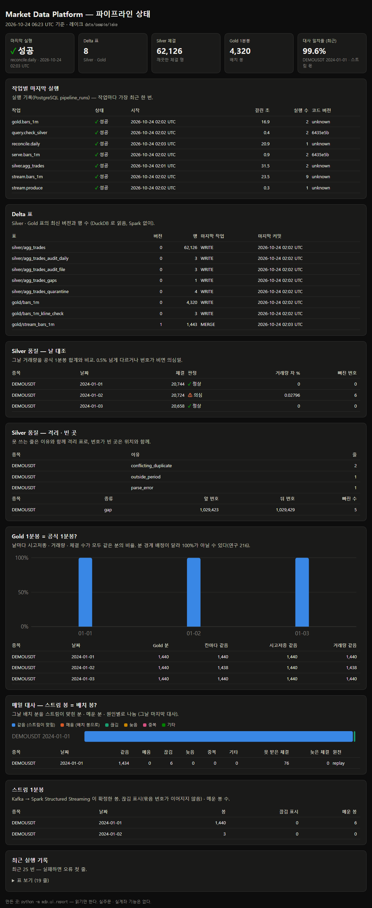

# 파이프라인 상태 화면 (README 6-3)

> 레이크(Delta 표) · 실행 기록 · 품질 감사 · 매일 대사를 **HTML 한 장**으로 보여 준다. 읽기만 한다.
> 코드: [`src/mdp/ui/`](../src/mdp/ui)



## 돌려 보기

```bash
python -m mdp.ui.report                    # <lake>/_ui/index.html 을 만든다 (브라우저로 연다)
python -m mdp.ui.report --serve 8765       # http://127.0.0.1:8765 — 열 때마다 새로 읽는다
```

- 레이크는 `MDP_LAKE_ROOT`, 실행 기록 · 대사는 `MDP_PG_DSN` (없으면 그 영역만 '주소가 없다'로 비고 나머지는 나온다).
- 자동으로 다시 만들어지는 곳: Airflow DAG 의 마지막 작업 `report` (진짜 레이크), 샘플 시연
  `python -m mdp.sample.demo` 의 끝 (`data/sample/ui/index.html`).

## 무엇을 보여 주나

| 영역 | 어디서 읽나 | 무엇을 보나 |
|---|---|---|
| 한눈에 | 아래 전부 | 마지막 실행 · Delta 표 수 · 국내 분봉 수 · 국내 유니버스 가격 줄 · 바이낸스 체결 · 1분봉 · 최근 대사 일치율 |
| 국내 주식 — 분봉 = 일봉? | `gold/kr_daily_from_minutes` | 종목마다 결과별 날 수 — 원주가와 같음 · 수정주가와 같음 · 마감 봉 없음 · 가격 기준 다름 (누적 막대 + 표) |
| 국내 주식 — 날 감사 · 시장 전체 빈 구간 | `silver/kr_minute_audit_daily` · `kr_minute_gaps` | 온전한 날 · 마감 봉 없는 날 · 장 후 봉, 모든 종목이 함께 빈 구간(늦게 열림 · 장 중 정지) |
| 국내 주식 — 수정주가 사건 · 생존 편향 | `gold/kr_adjustment_events` · `kr_survivorship_yearly` | 종목마다 사건 수 · 가장 큰 배수, 해마다 전체 vs 생존만 평균과 차이(%p, 음수인 해가 있어 막대 없이 표로) |
| 국내 주식 — 실시간 대사 | `gold/kr_reconcile_daily` | 같음 · 못 받음 · 체결 놓침 · 값 다름 (표가 없으면 '아직 없음') |
| 작업별 마지막 실행 · 최근 실행 | PostgreSQL `pipeline_runs` | 상태(아이콘 + 글자) · 걸린 시간 · 코드 버전 · 실패 이유 |
| Delta 표 | `_delta_log` + DuckDB | 표마다 최신 버전 · 행 수 · 마지막 작업(WRITE · MERGE) · 시각 |
| Silver 품질 | Silver 감사 표 | 날 대조(정상 · 의심) · 격리 이유별 줄 · 빈 곳 위치 |
| Gold = 공식 봉 | `bars_1m_kline_check` | 날마다 칸마다 같은 분의 비율 (막대) |
| 매일 대사 | PostgreSQL `reconcile_daily_latest` | 날마다 분 구성 — 같음 · 메움 · 끊김 · 늦음 · 중복 · 기타 (누적 막대 + 범례 + 표) |
| 스트림 1분봉 | `stream_bars_1m` | 날마다 봉 · 끊김 표시 · 메운 봉 |

## 왜 이렇게 만들었나

- **정적 페이지** — dbt docs · Great Expectations 'Data Docs' 처럼 파일 하나다. 서버 · 계정 없이 열리고, 파이프라인이
  끝날 때마다 다시 만들면 된다. 새 의존성이 없다(DuckDB · psycopg 는 이미 쓰고 있다).
- **영역마다 따로 읽고, 실패해도 그 영역만 비운다** — 아직 만들지 않은 단계 · 꺼진 DB 때문에 화면 전체가 죽지 않는다.
- **받은 레이크만 읽는다** — PostgreSQL 은 진짜 · 샘플 레이크가 함께 쓰므로, 실행 기록 · 대사는 그 레이크의 종목으로
  거른다(종목이 없는 실행은 늘 보인다). 시험을 쓰다 '표 목록은 샘플, 행 수는 진짜 레이크' 로 섞여 읽는 버그를 찾아 고쳤다.
- **화면 갈무리에 개인 경로가 찍히지 않게** — 레이크 위치는 저장소 기준 상대 경로로 보인다.
- **그래프 규칙** — 한 축만, 막대는 바닥선에 붙고 위만 둥글게, 누적 칸 사이 2px 틈, 범례 + 표가 늘 함께(색만으로
  말하지 않음), 상태는 아이콘 + 글자, 밝은 · 어두운 화면 색을 따로 정함. 범주 색 6 개는 색각 이상 검사를 통과한
  순서 그대로 쓴다(이웃 쌍 ΔE 9.1 밝은 · 8.4 어두운, 정상 시력 19.6 · 19.3). 밝은 화면에서 대비 3:1 이 안 되는
  색 3 개가 있어 범례 · 표를 함께 둔다. 아주 작은 원인(1,440 분 중 6 분)도 보이게 0 이 아닌 칸은 적어도 5px.
- 스트림 작업의 실행 기록에는 종목이 없어서, 어느 레이크 화면에나 보인다(확인한 한계).

## 시험

[`tests/mdp/test_ui.py`](../tests/mdp/test_ui.py) — 값 이스케이프 · 역슬래시 경로 · 영역 오류 표시 · 레이크 종목으로
거르기 · 상태 아이콘 + 글자 · 누적 막대 최소 너비 · Delta 로그 읽기 · 빈 레이크 · (샘플을 돌렸으면) 샘플 레이크 실제 읽기.
