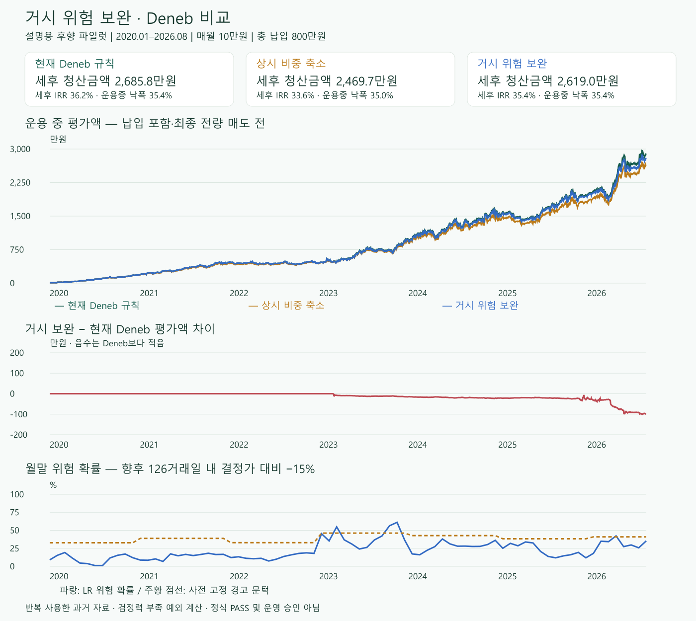

# 281 — Deneb 거시 위험 보완 결과: 후향 파일럿에서 불리

2026-10-18 Codex · **EXPLANATORY_RETROSPECTIVE_COMPLETED / ADOPTION_UNVERIFIED**.
정식 PASS·독립 OOS·Paper/Live 승인은 없다. 결과 후 재튜닝·재학습·다른 배율 탐색은 0회다.

## 1. 결론

이번 고정 설계에서는 거시 위험 보완을 Deneb에 추가할 실용적 이점이 보이지 않았다.
2020-01~2026-08 매월 10만원(80회, 총 800만원), 원래 Deneb 연구 계좌의 세후 청산금액은
**2,685.8만원 → 거시 보완 2,619.0만원**, **66.9만원 감소**. 운용 중 최대 낙폭은 둘 다 35.44%.
비용 2배와 거시 실행 1거래일 지연에서도 비교 증분은 음수였다.

**거시 정보 전체가 무의미하다는 결론은 아니다.** 최초 학습은 17개월·하락 정답 2개뿐이며
이후 expanding 학습도 큰 위험 사건 수가 적다. 이번 자료·정답·모델·정책의 실용적 추가 근거가 없다는 뜻이다.

## 2. 무엇을 어떻게 실행했나

1. [G0 감사](281-deneb-macro-risk-g0.md): ALFRED 최초 발표7개 계열·발표 지연·판본·검정력 점검.
   공통 판본2014년부터 → 준비기간 뒤2015년 입력. 80% 검정력 미확인.
2. 사용자 **설명용 후향 파일럿1회 예외** 승인. [사전 명세](281-deneb-macro-risk-pilot.md) `b54dbb2`,
   회계 검산·마지막 청산 비용/말년 통산 명시 및 구현 동결 `07f24a5` 후 실제 학습.
3. INDPRO·근원PCE는 같은 과거 판본 안의3개월 변화를 사용(다른 기준연도 최초 지수를 이어 붙이지 않음).
   월말2거래일 전까지 공개된 정보만, 입력139개월(2015-01~2026-07), 거시 결측0인 행128개.
4. 거시10개+가격 통제3개. Train-only1/99%clip·중앙값 대체·결측 표시·표준화.
   정답은 결정가 대비 다음126거래일 최저 종가가−15% 이하인지. 모델마다 같은 정답/자료.
5. CONST·LR(C0.1)·작은GBM, 가격-only LR 진단. 해마다 label이 완전히 끝난 행만 확장 학습.
   첫2017 모형17행/양성2 → 마지막2026 모형125행/양성25. 연도별3개 총30개 가중치 저장.
6. 학습 뒤 기존 회계 의존성`httpx`가 없어 **손익 계산 전 중단**. 최초 시도 보존,
   기존 의존성 경로를 참조하고 저장30개 모델만 재생(추가fit0, 해시 전부 동일)하여 미실행 회계 완료.
   [검증 기록](281-deneb-macro-risk-validation.md), `4495b24`.
7. 고정 A/B/C × 비용기본/2배/거시1일지연 × 검증/역사확인 =18계좌.
   계산 결과·예측·전처리·가중치 SHA·전체 원장 보존. 다른 시드/문턱/배율로 재시험하지 않았다.

G0의 역사확인74개월은 **결정월2020-01부터**의 최대치다. 파일럿은 **집행일2020-01부터**라
2019-12 결정1개가 포함되어 정답 완성 예측은75개다. 정답이 끝나지 않은2026-03 이후 예측은
계좌 재생에는 쓰되 분류 성적에는 넣지 않았다. 2026-09 이후 가격/정답·208은 미사용.

## 3. 비교군

| 비교군 | 구성 | 무엇을 비교하나 |
|---|---|---|
| A | 184형 Deneb: 변동성 비중+T브레이크+추세 복귀 | 보완 대상 원래 규칙 |
| B | A의 TQQQ 목표에 항상 0.9210526배, 나머지 현금 | 단순히 위험을 덜 부담한 대조 |
| C | LR p≥학습 기저율 2배면 TQQQ 목표 0.5배, 낮아지거나 가격 복귀면 1배 | 위험 시점 선택의 가치 |

B는 첫 Train의 평활 기저율0.1578947로 성과 전에 결정했다. C와 실제 평균 노출이
정확히 같지는 않으며, 사후 평균 노출에 맞춰 B를 조정하지 않았다.
기존 T브레이크가 우선이고, 거시 해제만으로 브레이크 대기금을 무조건 재투자하지 않는다.

## 4. 역사확인 계좌 — 2020-01-02~2026-08-31

초기 일시금 0 · 매월 10만원 · 총납입 800만원 · 금액 단위 **만원**.

| 항목 | A 원래 Deneb | B 상시 축소 | C 거시 보완 |
|---|---:|---:|---:|
| 세후 최종 청산금액 | **2,685.8** | 2,469.7 | 2,619.0 |
| 원금 제외 순이익 | **1,885.8** | 1,669.7 | 1,819.0 |
| 세후 연환산수익 IRR | **36.16%** | 33.59% | 35.39% |
| 납세 반영 운용 NAV CAGR | **40.11%** | 36.99% | 39.27% |
| 납세 반영 운용 Sharpe(무위험0) | **1.319** | 1.303 | 1.300 |
| 운용 중 최대 낙폭 | 35.44% | **34.98%** | 35.44% |
| 평균 TQQQ 펀드 비중 | 39.93% | 36.64% | 39.66% |
| 최대 TQQQ 펀드 비중 | 66.16% | 61.60% | 66.16% |
| 연간 회전율(매수+매도) | 2.97배 | 2.86배 | 3.14배 |
| 모형 매수·매도 기록 | 203건 | 204건 | 210건 |
| 거래비용(최종 청산 포함) | 31.30 | 28.12 | 32.23 |
| 납부+마지막 청산 세금 | 252.97 | 199.60 | 235.32 |

IRR은 적립 시점·마지막 청산세금/비용을 반영한다. NAV CAGR/Sharpe/MDD는 운용 중 단위 NAV라
**마지막 전량청산 정산 전**이다. 두 연환산 수익을 같은 뜻으로 읽지 않는다.
매매 건수는 실제 주문 건수가 아니며, 마지막 보고용 전량청산은 별도 비용 정산이다.

C는 B보다 149.3만원 높지만 평균 TQQQ 비중도 더 크다. **B보다 좋다는 사실만으로
경고 능력을 입증할 수 없다.** 핵심 비교인 C−A가 −66.9만원이고 낙폭 개선도 없다.

그래프 첫째/둘째는 운용 중 평가액(납입 포함·마지막 청산 전)이다.
그래프의 끝 차이와 표의 세후 청산 차이가 다른 이유는 최종 비용·세금 정산이다.
차이 패널을 따로 두어 겹친 세 선만으로 우위를 오해하지 않게 했다.

## 5. 예측 자체는 나았나

역사확인에서 정답이 완성된 예측 75개·하락 정답 16개. 서로 겹친 6개월 창이라 75개 독립 사건이 아니다.

| 모델 | Brier(낮을수록 좋음) | Log-loss(낮을수록 좋음) | ROC-AUC | PR-AUC |
|---|---:|---:|---:|---:|
| 연도별 학습 기저율 | **0.1762** | **0.5453** | 0.2617 | 0.1646 |
| 거시+가격 LR | 0.2011 | 0.6106 | 0.3708 | 0.1728 |
| 거시+가격 작은GBM | 0.2042 | 0.6446 | 0.2590 | 0.1566 |
| 가격-only LR | 0.1848 | 0.5724 | 0.2362 | 0.1456 |

주 LR의 확률 오차는 기저율보다 크고 가격-only보다도 크다. GBM이 단순 모형을 이긴 근거도 없다.
기저율은 해마다 다시 계산되므로 전 기간 같은 상수는 아니다(따라서 AUC가0.5로 고정되지 않음).

- 정답 완성 경고3건: **2023-02-28,09-29,10-31**, 모두 목표인 다음126거래일−15% 미발생.
  이 문턱에서 precision0/3, recall0/16. 미완성 정답을 오경보로 세지 않았다.
- 2026-03-31도 경고였지만6개월 끝은 보존 경계 뒤다. **정답미완성**, 분류 성적에서 제외.
- 보정표상 예측40~60%4개·60~80%1개는 완성된 정답 발생률0%였다.
  표본이 작으므로 정확한 확률로 신뢰할 수 있다는 근거가 아니다.
- 2017~2019 검증에서도 LR Brier0.1876 > 기저율0.1714. LR 경고0개, C계좌=A계좌.

이번 결과에서 확률의 부호를 뒤집거나 경고 문턱을 내려 재시험하지 않는다.
예측 단계부터 개선이 없으므로 더 큰 신경망으로 넘어갈 근거도 생기지 않았다.

## 6. 실제 축소와 복귀

| 집행일 | 사건 | 그때 기존 T브레이크 | 설명 |
|---|---|---:|---|
| 2023-03-01 | 거시 위험 진입 | 0 | TQQQ 축소 |
| 2023-03-08 | 가격 추세 복귀 | 0 | 거시 개선을 기다리지 않고 정상 배율 |
| 2025-12-01 | 결측 방어 | 1 | 실업·산업생산·근원PCE 파생변수 미확보로0.5 |
| 2026-01-02 | 거시 해제 | 1 | 기존 T브레이크를 건너뛰지 않고 보관금 처리 |
| 2026-04-01 | 거시 위험 진입 | 1 | 이미 브레이크가 일부 줄인 상태에 추가 축소 |
| 2026-04-10 | 가격 추세 복귀 | 1 | 가격 복귀 우선 상태 전이 |

단계는 해당 거시 행동 직전의 브레이크 상태다. 거시 배율이 0.5였던 날은 총 33거래일.
2023-09/10의 높은 예측은 가격 복귀 뒤 같은 위험 사건의 재경고 잠금 때문에 실제 재축소하지 않았다.
**가격 복귀 구조는 작동했다.** 하지만 '거시가 좋아질 때까지 대기' 계좌를 따로 비교한 연구는
아니므로, 이 복귀 방식 자체의 독립적인 수익 우위를 주장하지 않는다.

2020~2022에 C의 추가 거시 축소는 없었다. 두 계좌의 최대 낙폭은 같은
**2020-02-19~03-23**에서 발생해 35.44%로 같았다. 2022년도 A/C 둘 다 −25.56%.
2023년 운용 NAV 수익은 A 81.35% / C 78.18%, 2026년 8월까지 A 42.67% / C 39.08%였다.

## 7. 왜 더 적게 남았나 — C−A 회계 분해

단위 만원. 동일 납입의 두 계좌 경로에서 일별 보유 차이로 분해한 값이다.

| 기여 | C−A |
|---|---:|
| TQQQ 하락일 보유 차이의 긍정 기여 | +184.49 |
| TQQQ 상승일 보유 차이의 부정 기여 | −243.16 |
| 그 밖 TQQQ 경로 차이 | +4.05 |
| **TQQQ 가격 기여 합계** | **−54.61** |
| SCHD 가격 기여 차이 | −28.96 |
| 추가 거래비용 | −0.93 |
| 세금 감소 | +17.65 |
| **최종 세후 차이** | **−66.85** |

세금 절약은 손실을 일부 줄였지만, 보유 경로의 수익 감소를 만회하지 못했다.
추가 거래비용은 약 0.93만원이라 **수수료만 낮추면 해결될 문제가 아니다.**
분해에는 경고 뒤 보유금액 차이가 누적된 복리 효과도 포함된다. '33일 동안만의 독립적인
피한 손실/놓친 상승', 또는 개별 경고의 인과효과라고 읽으면 안 된다. 전체 증분 항등식은 검산했다.

## 8. 비용·지연 민감도

| 고정 조건 | A 세후 청산금액 | C 세후 청산금액 | C−A |
|---|---:|---:|---:|
| 편도0.15% | 2,685.82만원 | 2,618.97만원 | **−66.85만원** |
| 편도0.30%(2배) | 2,636.34만원 | 2,568.37만원 | **−67.97만원** |
| 거시 실행1거래일 추가 지연 | 2,685.82만원 | 2,639.29만원 | **−46.54만원** |

지연이 이번 경로에서 손실을 줄였어도 주 규칙을 바꾸지 않는다. 세 조건 모두 원래 Deneb보다 적었다.

## 9. 회계·재현 검증과 한계

- 주문·납세 기록을 이용해 18계좌·21,852일을 독립 재생: 수량 오차 0,
  현금 최대 5.5e−21원·평가액 최대 1e−20원. 일별 회계 자체 최대오차 2e−20원.
- A를 원래 184와 같은 실제 가격/기간/납입으로 다시 대조: 최대 NAV 차 1.07e−14,
  legacy 최종금액 차 7.46e−9원 이내. [감사 JSON](../../reports/deneb_macro_281/accounting_audit.json).
- 가중치 30개 SHA 전부 동일, 저장 모델 재생 오차 0, 복구 fit 0. 모델 선택/재튜닝 없음.
- 전체 pytest 4358 통과·10개 선택 의존성 skip. 연구 환경 leakage는 152개 전부 통과(skip 0).
  신규 24개·신규 strict 9파일·ruff/format·import 5경계 정상.
  기존 전역 mypy 7건·ruff 16건·포맷 3파일은 수정하지 않았고 전체 정상으로 표시하지 않는다.
- 연구 기준선은 **184형 소수점·고정환율 1,400원·수정주가 회계**다.
  현재 실거래의 1주 단위·실제 LOC 체결/미체결·환전·배당 지급 현금과 원천세를 완전히 재현하지 않았다.
  전날까지 신호/거시 월말 뒤에 집행해 같은 봉 미래 누수는 피하지만, 종가 전량 체결은 여전히 모형이다.
- 세금은 개인의 다른 해외주식 손익을 모르고, 과거 세금 납부는 비례 축소 근사다.
  마지막 전량 매도 비용과 말년 손익 통산은 같은 방법으로 A/B/C에 반영했다.
- **35.44%는 운영 30% 한도 안전성을 인증한 값이 아니다.** 전역 HALT/정지·보호주문/실제 체결 parity는
  검증하지 않은 규칙 계좌다. 과거 184의 31.7%와 기간·시작점·납입도 다르다. 실제 Deneb 정지는 유지한다.
- 2014년 이전 자료가 경제적으로 존재하지 않았다는 뜻이 아니라, 이번 공개 경로의 시점 복원 범위다.
  초기 17개 학습 월·위험 사건 부족은 계속 남고, 이미 본 역사는 독립 OOS가 아니다.

## 10. 다음 판단

**이번 LR 거시 위험 배율을 Deneb 실거래/기존 Paper에 추가하지 않는다.**
기존 280 그림자 기록과 현재 운영/정지 설정은 그대로다. '거시지표를 더 넣거나 큰 모델로 바꾸면 된다'고
같은 자료에서 탐색을 반복하지 않는다. 새 버전이 필요하다면 더 긴 시점 자료와 기존 방어 전에 행동할 수 있는
정보원부터 다시 감사해야 하며, 이번 결과로 새 임계값을 정하지 않는다.

기록: [원결과](../../reports/deneb_macro_281/pilot_result.json),
[연도/사건](../../reports/deneb_macro_281/yearly_and_events.json),
[원장 SHA·위치](../../reports/deneb_macro_281/pilot_result.json).
원자료·가중치·전체 원장은 `data/research/deneb_macro_281/`(Git 밖)에 보존했다.
