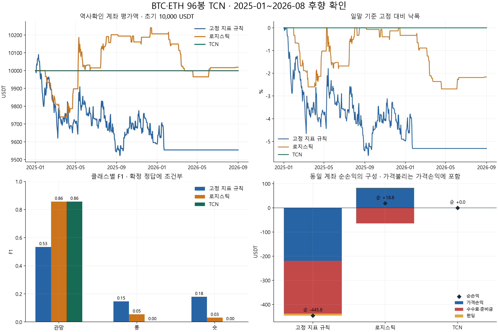
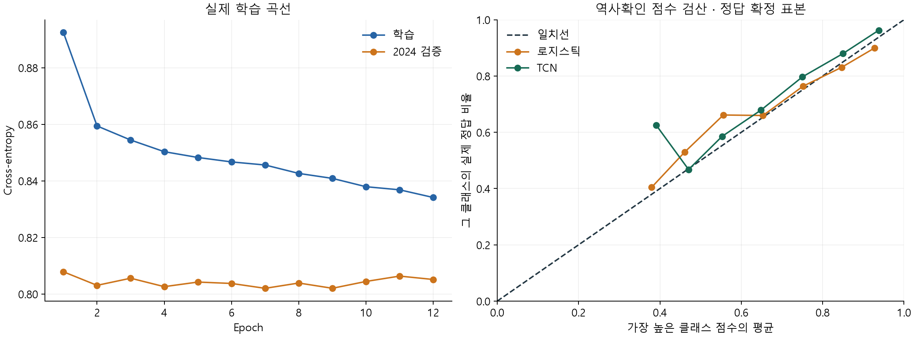

# BTC·ETH 차트 TCN — 실제 학습·거래 비교 결과

2026-10-18 · **학습/후향 비교 완료 · 실용적 매매 우위 미확인**.
기존 전략과 연구 판정은 그대로다. 이 문서는 독립 미사용 OOS나 정식 PASS가 아니다.

## 1. 무엇을 실행했는가

BTC·ETH 선물 4시간봉의 최근96개(16일) 변화 과정을 공통 가중치로 학습했다.
입력은 상대OHLC·수익률·봉범위·상대거래량·SMA20/60 거리·RSI14·ATR14/가격 10개다.
여기서20/60은 일수가 아니라 **4시간봉 개수**다. 절대가격·종목ID·날짜는 넣지 않았다.

같은96×10 입력의 L2 로지스틱(LR), 작은TCN, 고정 지표규칙(RULE)을 비교했다.
RULE은 C>SMA20>SMA60·RSI>50이면 롱, 반대면 숏, 나머지 관망이다.
현재 실거래 Vega/Altair를 바꾸거나 그대로 대조한 결과가 아니다.

| 항목 | 실제 실행 |
|---|---|
| 학습 기간 | 2020-07-01~2023-12-31, 경계26시간 purge |
| 중단시점 검증 | 2024년, 동일 purge |
| 최종 역사확인 | 2025-01-01~2026-08-31, 20개월 |
| 학습/검증/확인 입력 | 15,336 / 4,380 / 7,284개 |
| 그중 정답 불명 | 94 / 12 / 41개, 모든 예측·계좌에는 보존 |
| 주 정답 | 고정24h/3%stop/비용 후20bp 초과 기회 중 롱·숏·관망 |
| TCN | 8,067개 파라미터, dilation1·2·4·8·16, seed20261018 하나 |
| 실제 학습 | CUDA RTX3060, 12epoch·27.65초, 7epoch 가중치 선택 |
| 중단 기준 | 검증손실 개선 없는5회, 최대30회. 최종확인으로 선택하지 않음 |
| 자원 | PyTorch 할당 VRAM 피크 약526MiB, 드라이버 전체 사용량은 아님 |
| 재생 | 저장 가중치 재추론 오차0, CPU/GPU 최대 차이2.38e-7 |

표본27,000개는 독립 거래27,000건이 아니다. 24시간 정답과96봉 입력이 겹치며,
BTC·ETH도 함께 움직인다. 과거 자료는 이미 다른 연구가 사용한 역사다.
학습용 minibatch만 섞었고, 시간별 Train/Test를 무작위 분할하지 않았다.

## 2. 가장 중요한 결과

**TCN은 최종확인7,284개 시점에서 전부 관망을 선택했고, 실제 가상체결은0건이었다.**
관망 정답이75%인 자료에서 정확도75%는 “계속 관망”과 같다. 따라서 높은 방향 예측력이나
수익을 얻은 결과로 읽으면 안 된다. 정답확정7,243개 중 롱891개·숏921개를 모두 놓쳤다.

| 역사확인 지표 | 고정 규칙 | 로지스틱 | TCN | 항상 관망/학습상수 |
|---|---:|---:|---:|---:|
| 정확도 | 37.98% | 74.76% | 74.98% | 74.98% |
| Macro F1 | 0.287 | **0.314** | 0.286 | 0.286 |
| TCN 롱/숏 재현율 | — | — | **0% / 0%** | 0% / 0% |
| Log-loss, 작을수록 좋음 | 확률모델 아님 | 0.7236 | **0.6768** | 0.7651 |
| Brier, 작을수록 좋음 | 확률모델 아님 | 0.3977 | **0.3755** | 0.4255 |

TCN의 확률 점수 자체에는 일부 개선이 있었다. 하지만 가장 높은 점수가 늘 관망이어서
롱·숏 매매로 연결되지 않았다. 확률 개선의 통계적 우위는 따로 확정하지 않았다.
이번 점수는 “3개 행동 중 사후 최선 행동” 확률이며, 실제 승률·기대수익률과 같지 않다.

손절 없는 순수24h 가격방향 진단도 별도로 기록했다. 로지스틱은 진입신호125개 중54.4%,
고정 규칙은4,238개 중47.81%였다. TCN은 방향 신호가0개라 방향 적중률을 계산할 수 없다.
이 적중률은 비용 후 거래 승률이 아니며, 아래 계좌 체결 수와도 다르다.

## 3. 비용 후 계좌 결과

모든 계좌는 구간별10,000 USDT 시작, 추가입금 없음, 레버리지1배,
진입 명목/증거금10% 상한, 동시에 한 포지션이다. 관망 현금의 이자는 넣지 않았다.
비용은 통상 편도0.095%(수수료0.05%+가격불리0.045%)와 실제funding이다.
가격한도·직전분 거래량0.1% 참여·수량내림·부분청산·손절·재진입대기·계좌정지를 적용했다.

| 2025-01~2026-08 | 고정 규칙 | 로지스틱 | TCN |
|---|---:|---:|---:|
| 초기 금액 | 10,000 | 10,000 | 10,000 |
| 최종 평가액, USDT | 9,554.16 | 10,018.84 | 10,000.00 |
| 비용 후 순손익, USDT | **−445.84** | **+18.84** | **0.00** |
| 전체 기간 수익률 | −4.46% | +0.19% | 0.00% |
| 연복리 | −2.70% | +0.11% | 0.00% |
| 일수익 Sharpe | −0.652 | 0.059 | 0.000 |
| 분봉 평가 최대낙폭 | −5.84% | −2.88% | 0.00% |
| 체결 거래 묶음 | 225 | 64 | 0 |
| 평균 명목노출 | 3.31% | 0.83% | 0.00% |
| 최대 평가명목노출 | 12.33% | 12.08% | 0.00% |
| 수수료, USDT | 217.77 | 63.99 | 0.00 |
| 가격불리 비용기여, USDT | 356.27 | 111.39 | 0.00 |
| funding 수입(+)/지출(−), USDT | −8.57 | +0.60 | 0.00 |

10%는 진입시 증거금 상한이다. 보유 후 가격이 오르면 평가명목 비중은10%를 넘을 수 있다.
가격불리는 실행가격에 이미 반영돼 있어 순손익에서 다시 빼면 중복 비용이다.
현재 최종계좌에 열린 잔량은 없지만, 고정 규칙은 한 거래에서 정해진 청산기간을 넘겨
신규진입을 중단했고 이후 기존 비상stop으로 잔량이 닫혔다. 2026년 초 이후 평평한 선은
“신호를 잘 걸렀다”는 뜻이 아니라 그 실행 정지의 결과다.

그림의 선은 일말 평가액/낙폭이다. 표의 최대낙폭은 분봉 평가이므로 더 클 수 있다.

## 4. 학습 성적과 이후 성적의 차이

| 모델 | 학습 순손익, USDT | 2024 검증 | 2025~2026 확인 |
|---|---:|---:|---:|
| 고정 규칙 | −12.00, 2건 후 실행정지 | −338.28, 114건 | −445.84, 225건 |
| 로지스틱 | **+8,620.84, 417건** | +38.15, 37건 | **+18.84, 64건** |
| TCN | −22.41, 4건 | 0.00, 0건 | 0.00, 0건 |

로지스틱의 학습 구간 수익을 미래 기대수익으로 쓰면 안 된다. 같은 입력으로 학습하지 않은
기간에서는 우위가 거의 사라졌다. 학습은 TRAIN 정답에 맞추는 과정이므로 이 차이는
일반화 부족과 일치하는 결과이지, 높은 TRAIN 수익의 실용성을 증명하지 않는다.
TCN도 TRAIN 손실은 계속 줄었지만 검증손실은7회 뒤 더 좋아지지 않아12회에서 멈췄다.

## 5. 롱·숏과 특정 시기의 기여

| 역사확인 기여 | 고정 규칙 | 로지스틱 | TCN |
|---|---:|---:|---:|
| 롱 순손익, USDT | −67.88, 108건 | **+98.29, 34건** | 0.00, 0건 |
| 숏 순손익, USDT | −377.96, 117건 | **−79.45, 30건** | 0.00, 0건 |
| BTC | −218.06 | −42.64 | 0.00 |
| ETH | −227.78 | +61.48 | 0.00 |
| 2025 종료 거래 | −410.39 | +206.50 | 0.00 |
| 2026 종료 거래 | −35.45 | −187.66 | 0.00 |

로지스틱의 작은 순이익은 롱에서 나왔고, 숏은 이를 줄였다. 가장 좋았던5거래가
+562.34 USDT를 벌었고, 이5개를 제외한 거래합은−543.51 USDT였다.
이는 수익 기여가 소수 거래에 몰렸다는 진단이며, 좋은 거래를 사후 선별할 수 있다는 뜻이 아니다.
TCN은 롱/숏 모두 실제 후속 구간 기여가 없었다.

## 6. 고정 민감도와 통계적 불확실성

| 역사확인 조건 | 고정 규칙 순손익 | 로지스틱 | TCN |
|---|---:|---:|---:|
| 기본 비용 | −445.84 | +18.84 | 0.00 |
| 수수료·가격불리2배 | −1,567.89 | **−3.38** | 0.00 |
| 진입을 추가5분 늦춤 | −757.85 | **−323.47** | 0.00 |
| 참여량 절반 | −433.25 | +18.26 | 0.00 |
| 정산mark 불리 경계 | −445.84 | +18.84 | 0.00 |

추가5분 검사는 “5분이 더 나쁜 최적값”을 찾는 탐색이 아니라 미리 정한 지연검사다.
이 숫자를 보고 진입시각·확률문턱·비용·label·class weight를 다시 고르지 않았다.
정산mark 경계가 거의 같다는 사실이 호가/체결 가정까지 검증한 것은 아니다.

20개월의 TCN−로지스틱 월수익 차이는 평균 약−0.01%p,
HAC lag3의2SE 구간은 약[−0.42%p,+0.39%p]다. 독립 우위를 확정할 근거가 없다.
TCN−고정 규칙은 관망으로 손실을 피한 효과일 뿐, 수익을 내는 매매법의 증거가 아니다.

## 7. 왜 관망이 많았는가 — 결과 후 진단

정답이 확정된7,243개 중 관망은5,431개(74.98%)였다. 같은 고정 정답을 다시 검산한
사후 진단에서 다음과 같이 나뉘었다. **새 모델이나 새 계좌 수익을 만든 재시험이 아니다.**

| 고정 정답의 이유 | BTC | ETH | 합계 |
|---|---:|---:|---:|
| 양쪽 모두 진입 미체결/수량조건 미충족 → 관망 | 2,541 | 926 | **3,467** |
| 체결 가능한 방향이 있어도 비용 후20bp 미달 → 관망 | 573 | 1,391 | **1,964** |
| 롱이 사후 최선 | 260 | 631 | 891 |
| 숏이 사후 최선 | 242 | 679 | 921 |
| 정답 불명, 계좌에서는 유지 | 26 | 15 | 41 |

따라서 이 실험의 관망 정답에는 방향뿐 아니라 **보수적인 체결 조건**이 크게 섞여 있다.
특히 고정한 불리 가격이 분봉 범위 안에 있어야 한다는 조건과 참여량/수량단위가
진입 가능성에 영향을 준다. 실제 과거 호가·큐 자료가 없어 이것이 현실의 미체결률과
같다고 인증할 수 없다. TCN 실패를 “모든 차트 정보에 예측력이 없다”로 확대하면 안 된다.

가중치 없는3분류 손실, 다수인관망, 비용/실행에 조건부인정답, 제한된입력에서
TCN이 관망 쪽에 머문 결과다. 학습이 정상 실행됐다는 것과 유용한 매매정책을 얻었다는
것은 별개다. 균형 가중치·다른 정답·작은 확률문턱을 사후 적용해 결과를 구제하지 않는다.

## 8. 자료·실행·검증의 한계

- BTC/ETH 각328만분 연속자료를 사용했지만, 같은 정밀도의 다종목1m가 없어 범위를 축소했다.
  폐지 코인까지 포함한 전체코인 모델의 일반화는 확인하지 않았다.
- funding rate/시각은 실제 자료, 정산mark는 각6,849건 중3,107건이 정확값,
  나머지3,742건은 hour시가 대리다. 2026-09 이후와 연구208 자료는 열지 않았다.
- 과거 거래규격·호가·주문확인·mark-stop/강제청산 tier·전체G5/G6/G7은 미복원이다.
  금융위험 한도 회계와 운영 실행기의 모든 gate 통과를 혼동하지 않는다.
- 첫 시도는 정답불명147개를 발견해 학습 전 중단했다. 이를 계좌에서 미래정보로 제외하지 않도록
  교정하고 새 커밋에서 학습했다. 첫 시도 산출물과 교정근거를 보존했다.
- 최종확인41개 불명정답은 분류 점수에서만 제외되고,7,284개 계좌기회에는 모두 포함됐다.
- 정해진 시간에 지정가 전량청산을 보장하지 못한 사례는 실패로 유지했다. 임의 시장가나
  잔량삭제로 좋은 성과를 만들지 않았다. 현재 기말 열린잔량0, 일부는 늦은비상stop으로 종료다.
- 이 실험은 시간분할1회다. walk-forward·다중seed·독립전향은 실행하지 않았다.

전체pytest4,272개, leakage142개, 신규pytest13+독립학습환경검사10개가 통과했다.
계층계약5개 유지, 새 코드 스타일과 핵심 strict타입 검사 정상. 전체프로젝트에는
기존mypy7건/ruff16건/포맷3파일이 남아 있다. [검증 기록](TCN_CHART_20261018_VALIDATION.md).

21개 계좌 모두 거래합·수수료·funding·월별복리·최종평가 일치, 동일시각 중복진입·60분대기·
증거금상한·미종결정지·모든입력기회 보존을 검산했다. 원결과JSON은 감사 전후 해시가 같다.

## 9. 최종 질문에 대한 답

1. **실제로 학습했는가?** 그렇다. LR와 작은TCN을 별도환경에서 학습하고 가중치·전처리·예측을 저장했다.
2. **이후 판단이 더 나았는가?** TCN 로그손실/Brier는 개선됐지만 행동은 모두관망,
   롱숏 재현율0이다. 유용한 방향판단 개선은 확인하지 못했다.
3. **비용 후 수익이 개선됐는가?** TCN0, LR+18.84 USDT이며 LR도 비용/지연에서 약해졌다.
   수익을 내는 실용적 추가우위는 확인되지 않았다.
4. **롱·숏 어느 쪽인가?** TCN 후속구간 양쪽0. LR의 작은우위는 롱, 숏은 손실이었다.
5. **추가 검증 가치가 있는가?** 현재 고정 후보의 Paper 승격이나 모델확대 근거가 없다.
   이번 후보는 종료하고, 필요하면 먼저 정답목표와 실행자료의 적합성을 별도로 검토해야 한다.
   같은 역사에서 class weight/문턱/모델크기를 바꿔 좋은숫자를 찾는 후속은 하지 않았다.
6. **주식 확장은?** 모델층은 시장정보와 분리했다. 자료/PIT·폐지/수정OHLC·배당·세션·휴장·
   거래정지·공매도대차·분봉·시장별비용을 새로 확보해야 한다. 특징층의4h연속성 검사도
   주식 세션 기준으로 교체한 새 버전이 필요하며, 코인 가중치를 검증 없이 옮기지 않는다.

## 10. 재현 위치

- [사전등록](TCN_CHART_20261018_PREREG.md): 25b51b8, 실행교정 e1bf580.
- `scripts/tcn_chart_20261018/`: data/features/dataset/models/execution/account/metrics/run 분리.
- `reports/tcn_chart_20261018/result.json`: 동결된21계좌·예측지표·기여·월별수익 원장.
  SHA256 `29fabb6c118908519b0ac83452aa19cbdc86d9eb323b50b8797341814ad51a7b`.
- `training.json`, `tcn.pt`, `lr.joblib`, `scaler.npz`, `predictions.npz`, `dataset_v2.npz`:
  실제학습·전처리·예측 증거. `posthoc_audit.json`: 원장/CPU재생/정답 원인검산.
- `attempt.json/dataset.npz/dataset_audit.json`: 최초중단, `attempt_v2.json`: 실제학습 실행.
- 원자료·가중치·큰JSON/배열은 Git밖 reports에 보존, 이 문서와그림·코드는 Git에 기록한다.
- 설치방식: [PyTorch 공식 로컬 설치 안내](https://pytorch.org/get-started/locally/).
